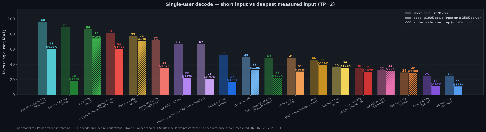
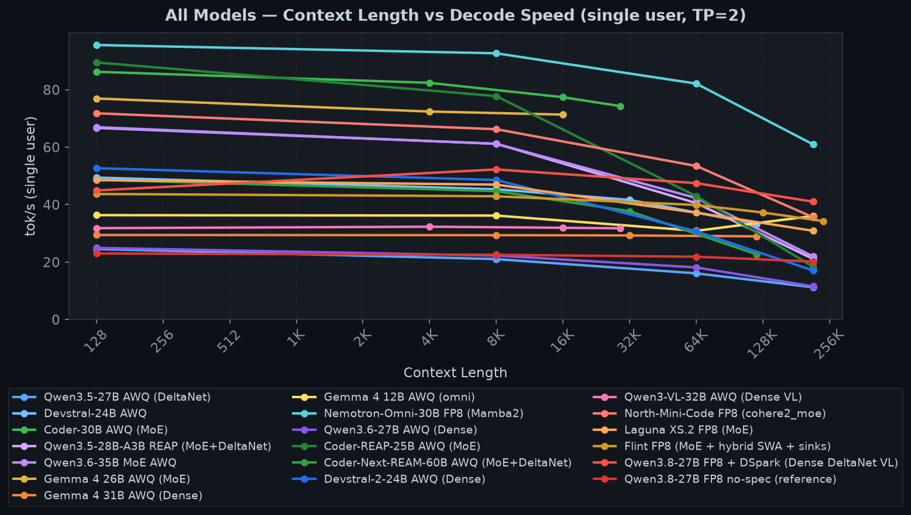
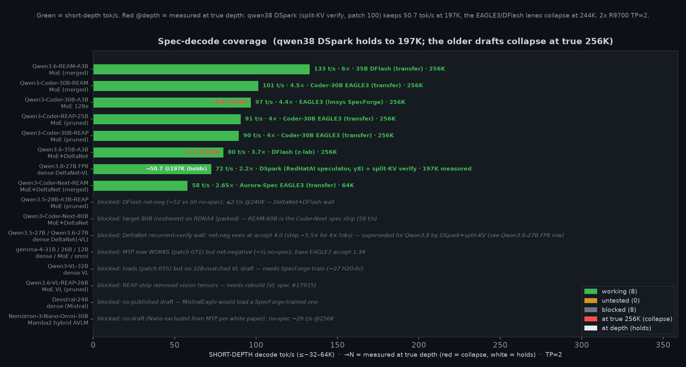
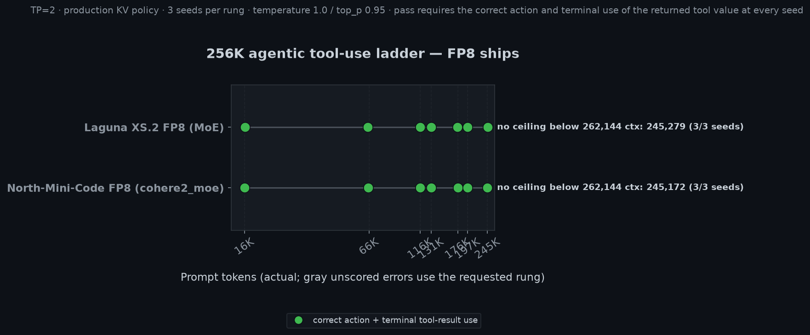
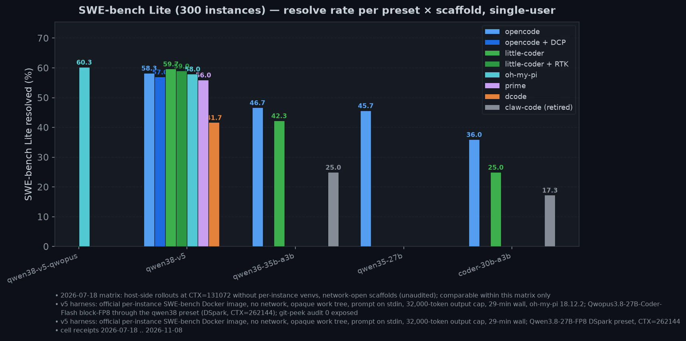

# RDNA4 inference on 2× R9700

SGLang v0.5.22 with 99 local RDNA4 patches, tuned for coherent single-user inference at long context
(256K) on two AMD Radeon AI PRO R9700 GPUs (gfx1201, 32 GiB each, TP=2 over PCIe). The repository holds
the patch series, the preset launcher, the benchmark and evaluation harnesses, the FP8/AWQ quantization
pipeline, and the receipts behind every number below. Multi-user throughput is secondary.

The focus is FP8 inference for coding and agentic workloads: Cohere North-Mini Code, Poolside Laguna XS.2,
and the quality flagship Qwen3.8-27B-FP8. Open work and known issues are tracked in
[GitHub issues](https://github.com/mattbucci/2x-R9700-RDNA4-GFX1201-sglang-inference/issues)
(known limitations carry the `known-issue` label:
[filtered list](https://github.com/mattbucci/2x-R9700-RDNA4-GFX1201-sglang-inference/issues?q=is%3Aissue+is%3Aopen+label%3Aknown-issue)); final
experiment dispositions are in [benchmarks/FINDINGS.md](benchmarks/FINDINGS.md); the experiment queue is
in [experiments/](experiments/README.md). The active performance programme is
[closing the gap to vllm-radiance](#closing-the-gap-to-vllm-radiance).

## Results

- **Eighteen presets boot and serve** on one launcher (`scripts/launch.sh`); every swept preset (16) emits
  parsed structured tool calls at boot.
- **Laguna XS.2 FP8 is the fleet-speed default**: 74.0 tok/s at 62 input tokens and 55.1 tok/s at 220K on
  the native Triton block-FP8 lane, with a 21/21 seed-rung 256K agentic ladder. North-Mini Code passes the
  same ladder 21/21 to 245,172 actual tokens.
- **Qwen3.8-27B-FP8 is the quality flagship**: fleet-best LAB-Bench 42.3 % (no-think multiple choice),
  MMLU 84.2 %, HumanEval 93.3 %, 7/7 agentic rungs to 245,150 actual tokens. The preset is DSpark
  speculative decoding through the split-KV verify kernel: **60.7 / 81.3 / 53.6 / 60.5 tok/s at 24 / 7.3K /
  58K / 197K input** (canonical think-off sweep, 5-run medians; the rate follows the text's acceptance) against
  35.6 / 34.9 / 33.3 / 29.9 on the no-spec server (`QWEN38_SPEC=0`; pools 733K no-spec, 429K with DSpark). Cold
  prefill of a 197K prompt is 98 s; a 1-token agentic turn on a 176K cached prefix is 0.17–0.35 s
  (`extra_buffer` hybrid cache + the 64-row split-KV turn route); capability probe 5/5.
- **Flint FP8 serves** (patch 105, strict tool schemas) with an FP8 KV cache (1.05M full-attention pool
  tokens, 2× bf16's): 45.3 → 38.6 tok/s from 14 to 219K actual input; basic / tool-call / thinking probes pass, the
  learned-sink kernels match a PyTorch reference, a 1-token agentic turn on a 104K cached prefix is 0.20 s (split-KV
  route), and natural-text needle retrieval holds to 131K at every depth and to the last 10 % of the window at 243–248K
  ([receipt](benchmarks/quality/flint/needle-natural-fp8-2026-10-31.md), [KV A/B](benchmarks/profiling/flint-ab-2026-11-01.md)).
- **The patch series replays byte-identically** onto pristine v0.5.22 under the strict gate in
  [`patches/README.md`](patches/README.md).

### Single-user decode across the fleet





Every model runs under its production preset (quantization, graph policy, KV dtype). Curves are
regenerated by [`generate_charts.py`](scripts/bench/generate_charts.py) from each
`benchmarks/<model>/results.json` (three-run streaming-TPOT median, decode-only, actual input-token
counts). "Short" ≈ 128-token input; "Deep" is the deepest measured input. Provenance, raw JSON, and
per-model curves are under [benchmarks/](benchmarks/README.md).

| Model | Class | Short tok/s (input) | Deep tok/s (input) |
|---|---|---:|---:|
| North-Mini-Code-1.0 | FP8 MoE + hybrid SWA | 71.8 (128) | 35.6 (197K) |
| Laguna-XS.2 | FP8 MoE + hybrid SWA | **74.0 (62)** | **55.1 (220K)** |
| Flint (40B/2.5B-active) | FP8 MoE + hybrid SWA + sinks, FP8 KV | 45.3 (14) | 38.6 (219K) |
| Nemotron-3-Nano-Omni-30B | FP8 Mamba2 hybrid MoE | 95.6 (28) | 60.9 (198K) |
| Qwen3-Coder-30B-A3B | AWQ MoE | 88.3 (20) | 57.2 (29K) |
| Qwen3-Coder-REAP-25B-A3B | AWQ MoE | 89.5 (20) | 18.4 (197K) |
| Qwen3-Coder-Next-REAM-60B | AWQ MoE + DeltaNet | 48.6 (20) | 22.7 (110K) |
| Qwen3.5-28B-A3B-REAP | AWQ MoE + DeltaNet | 66.7 (22) | 21.1 (197K) |
| Qwen3.6-35B-A3B | AWQ MoE + DeltaNet | 67.0 (22) | 22.0 (197K) |
| Gemma 4 26B-A4B | AWQ MoE + SWA | 74.8 (25) | 58.3 (15K) |
| Devstral-24B | AWQ dense | 47.9 (15) | 23.0 (110K) |
| Devstral-Small-2-24B | AWQ dense + vision | 52.7 (15) | 17.0 (198K) |
| Qwen3.5-27B | AWQ dense + DeltaNet | 24.5 (22) | 11.2 (197K) |
| Qwen3.6-27B | AWQ dense + vision | 24.9 (22) | 11.5 (197K) |
| Qwen3.8-27B | official FP8 dense + DeltaNet (VL + video) | 35.6 (24) | **29.9 (197K)** |
| Qwen3-VL-32B | AWQ dense + vision | 23.4 (20) | 16.5 (27K) |
| Gemma 4 31B | AWQ dense + SWA | 29.4 (25) | 10.5 (110K) |
| Gemma 4 12B | AWQ omni + SWA | 38.6 (25) | 10.9 (198K) |

Gemma 4 26B-A4B caps near 16–30K in its current SWA configuration; the full Coder-Next-80B AWQ
checkpoint is pending (the REAM-60B variant is measured). Do not present a short prompt on a 256K-capable
server as 256K-depth throughput.

#### Speculative decoding across the fleet



Only Qwen3.8-27B drafts hold a gain at depth: the preset's DSpark lane (RedHatAI speculator through the split-KV
verify kernel), 60.5 tok/s at 197K actual input against 29.9 no-spec; a DFlash2 drafter also holds and is not
adopted (one needle miss). Every other EAGLE3/DFlash draft that wins at short depth collapses at true 256K
(0.8–1.2 tok/s at 240–244K): green bars are short-depth capability. Data: [`benchmarks/specdecode.json`](benchmarks/specdecode.json).

### 256K agentic tool-use ladder



Seven rungs from 16K to ~245K actual prompt tokens, three seeds per model at the model's recommended sampling,
8,192-token budgets on both turns. Green requires the correct `BANANA42` action and terminal semantic use of the
`KIWI77` tool result **on every seed**; purple is completion-budget exhaustion (excluded from the action-rate
denominator); red is an invalid or missing primary tool call. The chart is generated from the six seed receipts in
[`benchmarks/quality/`](benchmarks/quality/) and fails closed if per-seed prompts differ. Qwen3.8-27B-FP8 has a
single-profile receipt ([JSON](benchmarks/quality/tooluse256k-qwen38-27b-fp8-v0518-r9700.json), 7/7 to 245,150 tokens).

### SWE-bench Lite (official Docker harness)



The chart is regenerated from the per-cell receipts in [`benchmarks/quality/bakeoff-*.json`](benchmarks/quality/)
([`aggregate_bakeoff.py`](evals/swebench/aggregate_bakeoff.py)). It holds the July matrix, the seven Qwen3.8-27B-FP8 v5
cells and the Qwopus3.8-27B-Coder-Flash cell on oh-my-pi
([receipt](benchmarks/qwopus38-27b-coder-flash-fp8/README.md)); each cell carries its harness line, and the
pre-sandbox qwen38-v2 cells stay flagged `superseded`.

**Qwen3.8-27B-FP8 v5** (DSpark preset, CTX=262144): seven scaffolds — opencode, opencode-dcp,
little-coder, little-coder-rtk, oh-my-pi, prime-agent, deepagents-code — at 300/300 instances each, every
scaffold inside the official per-instance SWE-bench image with no network, an opaque work tree, the task
prompt on stdin and a 32,000-token output cap, Docker-scored with the official harness:

| Scaffold | little-coder | little-coder-rtk | opencode | oh-my-pi | opencode-dcp | prime-agent | deepagents-code |
|---|:---:|:---:|:---:|:---:|:---:|:---:|:---:|
| Resolved / 300 | 59.7% | 59.0% | 58.3% | 58.0% | 57.0% | 56.0% | 41.7% |

Six scaffolds sit within four points; deepagents-code's gap is its own harness (91 of 300 sessions ran to the wall
with no diff). All 2,100 sessions are audited: one infrastructure row (a server 5xx), zero git-history reads, and
every upstream web attempt blocked by the sandbox (`audit_git_peek.py`, sandbox-aware). The Qwopus fine-tune on
the oh-my-pi lane scores 60.3% against this model's 58.0% on identical instances, a difference inside noise
(McNemar p = 0.36) with a third of the empty patches. Every lane keeps the same 29-minute wall. With six scaffolds inside four
points, new models and presets are scored on oh-my-pi alone (`SCAFFOLDS=omp`); the full matrix is run only to
investigate a hosting error. Setup, audits and dispositions: [`evals/swebench/FP8_BAKEOFF_SETUP.md`](evals/swebench/FP8_BAKEOFF_SETUP.md)
and [`benchmarks/FINDINGS.md`](benchmarks/FINDINGS.md).

The [July matrix](evals/swebench/bake-off-2026-07-18.md) (coder-30b-a3b 36.0%, qwen35-27b 45.7%, qwen36-35b-a3b 46.7%
on opencode; host-side rollouts at CTX=131072, sessions not audited for git/web exposure) is comparable within itself only.

### Closing the gap to vllm-radiance

[vllm-radiance](https://github.com/magiccodingman/vllm-radiance), a hand-tuned RDNA4 vLLM fork, leads this stack on the same two cards and
Qwen3.8-27B files ([receipt](benchmarks/radiance-parity/README.md)). Decode is tok/s at 24 / 7.3K / 58K / 197K input; prefill is cold tok/s.

| Lane | vllm-radiance | This stack | Gap | Experiments that close it, in run order |
|---|---|---|---|---|
| FP8, no speculation | 35.4 / 35.0 / 33.7 / 30.4 | 35.6 / 34.9 / 33.3 / 29.9 | 1.00–1.02× | RAD-22 decode GEMV, RAD-5a Triton norm, RAD-23 DeltaNet GEMV, RAD-25 in-graph all-reduce and RAD-30 BF16 attention sum are in the preset (patches 122–124, 129, 130); RAD-15 int8 LM head is opt-in for greedy decode (patch 127, +1–2.5 %); its sampling path, RAD-3 GEMM weight layout |
| FP8 + DFlash2 | 99.9 / 99.7 / 87.9 / 91.0 | 81.2 / 85.8 / 76.1 / 57.6 | 1.2–1.6× | RAD-27 grouped verify prefix stage and RAD-29 verify-row GEMM are in the preset (patches 125, 128; 126 is DSpark's draft stage); RAD-18 content-adaptive block length, RAD-7 low-bit draft head |
| Cold prefill | 4,137 / 3,631 / 2,520 | 2,854 / 2,618 / 2,027 | 1.2–1.5× | RAD-30 and the RAD-10c prefill attention kernel are in the preset (patches 130, 131); RAD-20 GEMM tiles at M ≥ 64 and chunk size |
| MXFP4, no speculation | 51.6 / 50.8 / 47.4 / 41.0 | 34.3 / 33.6 / 31.8 / 28.4 | 1.4–1.5× | RAD-11 split-layout census and the M > 32 repack path, RAD-21 MXFP4 + DFlash2 |

Measurement runs first (RAD-2, 12, 13, 14, 10 and 16 need no tree change) so ports follow measured worth. Targets: 33 tok/s
no-spec and 90 with DFlash2 at 24 tokens, 80 at 197K, prefill 3,500 tok/s at 7.3K, needle and capabilities unchanged.
Specs: [experiments/19](experiments/19-vllm-radiance-parity.md); tracking: [#40](https://github.com/mattbucci/2x-R9700-RDNA4-GFX1201-sglang-inference/issues/40).

## Presets

`scripts/launch.sh` is the source of truth for model paths and runtime flags.

| Preset | Model family | Primary lane | Context |
|---|---|---|---:|
| `north-mini` | North-Mini-Code-1.0 | FP8 MoE + hybrid SWA | 256K |
| `laguna` | Laguna-XS.2 | FP8 MoE + hybrid SWA | 256K |
| `flint` | RecursiveSI Flint (patch 105) | FP8 MoE + hybrid SWA + learned sinks, FP8 KV | 262K |
| `coder-30b` | Qwen3-Coder-30B-A3B | AWQ MoE | 32K default; 256K capable |
| `coder-reap-25b` | Qwen3-Coder REAP 25B-A3B | AWQ MoE | 256K |
| `coder-next` | Qwen3-Coder-Next-80B (diagnostic preset) | AWQ MoE + DeltaNet | 128K |
| `coder-next-ream` | Coder-Next REAM | AWQ MoE + DeltaNet | 128K |
| `devstral` | Devstral-24B (patch 083 tokenization) | AWQ dense | model preset |
| `devstral2` | Devstral-Small-2-24B | AWQ dense + vision | 256K |
| `qwen35` | Qwen3.5-27B | AWQ/FP8 DeltaNet | 256K |
| `qwen35-moe` | Qwen3.5-35B-A3B | AWQ MoE + DeltaNet | 256K |
| `qwen36-27b` | Qwen3.6-27B | AWQ/FP8 DeltaNet + vision | 256K |
| `qwen38` | Qwen3.8-27B | official FP8 (block) DeltaNet + vision + video + DSpark draft | 256K (429K pool; 733K with `QWEN38_SPEC=0`) |
| `qwen36-moe` | Qwen3.6-35B-A3B | AWQ/FP8 MoE + DeltaNet | 256K |
| `qwen3vl-32b` | Qwen3-VL-32B | AWQ dense + vision | 256K override |
| `gemma4` | Gemma 4 26B-A4B | AWQ/FP8 MoE + vision | 256K |
| `gemma4-12b` | Gemma 4 12B Unified | AWQ multimodal | 256K |
| `gemma4-31b` | Gemma 4 31B (text only: the local AWQ checkpoint has no vision tower) | AWQ dense | 256K override |
| `nemotron-omni` | Nemotron-3-Nano-Omni | FP8 Mamba2 hybrid MoE | 256K |

Additional fallback presets exist for Gemma 4 31B checkpoint formats; `./scripts/launch.sh -h` lists
everything. Use the 12B or 26B Gemma presets for multimodal workloads.

### Runtime policy

- Use CUDA/HIP graphs for dispatch-bound MoE and recurrent hybrid presets; keep compute-bound dense
  presets eager unless an A/B shows a gain (qwen38 dense DeltaNet FP8 gains +26–33 % on M=1 decode with
  identical outputs, so it runs graphs).
- Use FP8 for native gfx1201 FP8 checkpoints and dense-thinking agentic workloads that lose quality
  under int4; use AWQ int4 for weight-bandwidth-bound single-user decode and for models that need the
  extra KV capacity. FP8 is the optimisation target on this rig; AWQ presets are maintained, not tuned.
- Flint runs an FP8 KV cache (`KV_DTYPE=auto` restores bf16 KV). The fp8 QK dot in extend attention (patch 108;
  `EXTEND_FP8_QK=0` restores the upcast) is on for `qwen38`, `flint`, `nemotron-omni`, `qwen36-27b`, `qwen36-moe`, `qwen35`
  and `devstral2`: cold prefill of a 197K prompt 332 → 211 s, 146 → 65 s, 72–86 → 33 s, 357 → 240 s, 117 → 74 s, 361 → 241 s
  and 394 → 188 s respectively, needle grids and the 256K reasoning probe equal on both arms.
- Use no speculative decoding at true 256K depth unless a same-depth A/B proves it. The one lane that
  does is `qwen38` + DSpark through the split-KV verify kernel (1.5–2.2× at 24 to 197K input), so it is
  that preset's default; beyond 208K it is not A/B'd (`QWEN38_SPEC=0` is the no-spec server). Every other
  trained-draft lane collapses at 244K (FINDINGS → Speculative decoding).
- Hybrid (DeltaNet/Mamba) presets whose template emits a think block run
  `--mamba-radix-cache-strategy extra_buffer` so agentic turns hit the cached state at the exact prompt end
  (`qwen38`, `qwen36-27b`, `qwen36-moe`, `qwen35`, `qwen35-moe`; `MAMBA_CACHE_STRATEGY=no_buffer` reverts;
  `nemotron-omni` stays on `no_buffer`: its restored state under `extra_buffer` fails the cache-hit consistency gate).
  Short cache-hit turns (≤ 256 new tokens) on `laguna`, `qwen38`, `qwen36-27b`, `qwen36-moe`, `qwen35`, `qwen35-moe`
  and `flint` (learned sinks carried) route through the split-KV verify kernel (`EXTEND_SPLITKV_MAX=0` disables).
- Treat tool-call and reasoning parsers as model-specific correctness settings, not optional
  presentation features.
- Keep the Triton cache warm when collecting comparative numbers; the first boot of a preset on a day and
  the first use of a new kernel tile both measure slow, so run A/B arms in both orders.
- On gfx1201, decode `num_kv_splits` defaults to 64 (patch 086), not the AMD default of 16, so the
  flash-decode grid fills the 64 CUs at long context; override with `SGLANG_KV_SPLITS_OVERRIDE`.
- Native Triton dense block-FP8 is Laguna's default (36.8–47.8 % over `auto`); roll back with
  `FP8_GEMM_BACKEND=auto ./scripts/launch.sh laguna`. The gfx1201 per-shape block-FP8 GEMM configs
  (patch 106) are qwen38-only; Laguna's dense FP8 slice is too small for them to matter. Do not use the
  stock SGLang block-FP8 tuner on gfx1201: it lacks the correctness gates Laguna's K=256 shape needs.
- Do not use DCP2 with the TP2 GQA coding presets ([#17](https://github.com/mattbucci/2x-R9700-RDNA4-GFX1201-sglang-inference/issues/17)).

### Validation and quantization

Every new or modified ship must pass weight and scale integrity, basic generation, the applicable
reasoning/tool-call/image/video/audio probes, long-context coherent generation, and a same-method
performance baseline:

```bash
python scripts/eval/check_awq_scales.py /path/to/awq --base /path/to/bf16
python scripts/eval/validate_capabilities.py --port 23334
bash scripts/quantize/run_full_pipeline.sh qwen35   # full AWQ pipeline, base check included
```

The AWQ base comparator distinguishes benign zero scales over dead MoE channels from zero scales over
live weights. Build `mattbucci/*` releases from the upstream BF16 checkpoint with the repository's own
calibration and pruning scripts; community quantizations are reference data, not release inputs.

## Quick start

```bash
./scripts/setup.sh
./scripts/launch.sh north-mini
./scripts/launch.sh laguna

python scripts/eval/validate_capabilities.py --port 23334
bash scripts/bench/bench_256k_sweep.sh north-mini
```

Common overrides:

```bash
CTX=262144 MEM=0.90 PORT=23335 ./scripts/launch.sh laguna
MODEL=/path/to/checkpoint ./scripts/launch.sh qwen36-moe
ENV_NAME=other-env SGLANG_DIR=/path/to/sglang ./scripts/launch.sh coder-30b
GPU_IDS=0 TP=1 ./scripts/launch.sh coder-30b
ENABLE_OVERLAP_SCHEDULE=1 ./scripts/launch.sh laguna  # experimental scheduler A/B
```

The model checkpoint controls compressed-tensors FP8 detection. Presets supply the validated attention
backend, quantization path, parsers, memory settings, and graph policy. Run `bash scripts/free_gpu.sh`
between serving runs: a hard kill leaks the RCCL communicator's `/dev/shm` IPC segments and a fast
relaunch faults on a stale one.

## Stack

| Component | Version |
|---|---|
| GPUs | 2× AMD Radeon AI PRO R9700, gfx1201, 32 GiB each |
| SGLang | v0.5.22 + 99 patches |
| Python | 3.12 |
| PyTorch | 2.11.0+rocm7.2 |
| ROCm | 7.2 |
| Triton | 3.6.0 |
| RCCL | 2.27.7 |
| transformers | 5.19.0 |

Serving tree `/data/sgl-v0522` on the peeled commit `baa9befa3` of v0.5.22, conda environment
`sglang-triton36-v0522`. Upstream `main` is not tracked: the series and the native HIP kernel builds pin
to release tags. v0.5.20 is retained at `/data/sgl-v0520` / `sglang-triton36-v0520` as the rollback. Rebase
procedure and per-version receipts: [`patches/README.md`](patches/README.md).

TP=2 requires both kernel P2P support and IOMMU passthrough:

```bash
zcat /proc/config.gz | grep -E 'CONFIG_HSA_AMD_P2P|CONFIG_PCI_P2PDMA'
grep -o 'iommu=pt' /proc/cmdline
```

Required kernel settings are `CONFIG_HSA_AMD_P2P=y`, `CONFIG_PCI_P2PDMA=y`, and the boot argument
`iommu=pt`. `HSA_FORCE_FINE_GRAIN_PCIE=1` remains enabled but is not a substitute for those
requirements. Because `iommu=pt` reduces DMA isolation, use this configuration only on a dedicated host
with trusted workloads; GPU passthrough is not a safe multi-tenant sandbox. Host boot settings and
operational invariants are in [`rules-for-agents.md`](rules-for-agents.md).

### OCI image

`Dockerfile` builds the ROCm 7.2/v0.5.22 stack without a GPU; GitHub Actions promotes verified digests
to `ghcr.io/<owner>/sglang-rdna4`. The image is hardened for untrusted networks (keyed API, fail-closed
preset launcher, disabled remote code and media by default) and must still sit behind a private network
and an authenticating TLS proxy. Device selection, secrets, `docker run` recipes, the read-only
root-filesystem layout, and the full threat model are in [`docker/README.md`](docker/README.md).

## Repo map

| Path | Purpose |
|---|---|
| [scripts/](scripts/README.md) | setup, launch, benchmark, evaluation, quantization, and test entry points |
| [patches/](patches/README.md) | ordered SGLang v0.5.22 patch series and the replay gate |
| [PATCHES.md](PATCHES.md) | cross-environment patch inventory |
| [benchmarks/](benchmarks/README.md) | current results, raw JSON, charts, and consolidated findings |
| [evals/swebench/](evals/swebench/FP8_BAKEOFF_SETUP.md) | SWE-bench Lite bakeoff harness, audit, and Docker scoring |
| [experiments/](experiments/README.md) | vetted experiment specs and the execution queue |
| [docker/](docker/README.md) | OCI image build, hardening, and run recipes |
| [CROSS-TEAM.md](CROSS-TEAM.md) | inbox for sister-rig notes and asks |
| [rules-for-agents.md](rules-for-agents.md) | operational and calibration invariants |
| [CLAUDE.md](CLAUDE.md) | concise repository working instructions |
