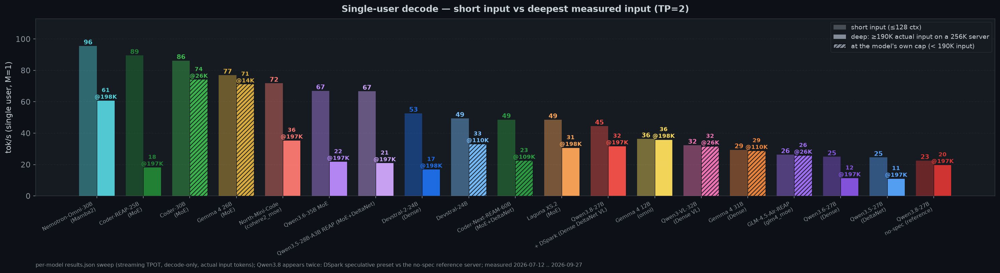
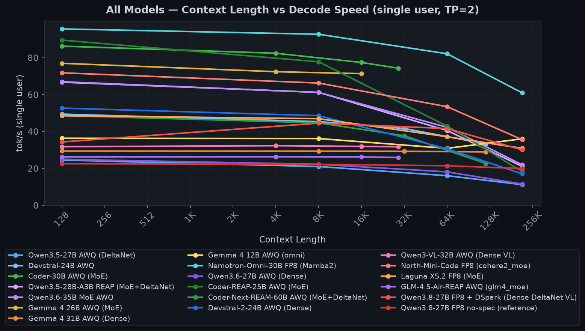
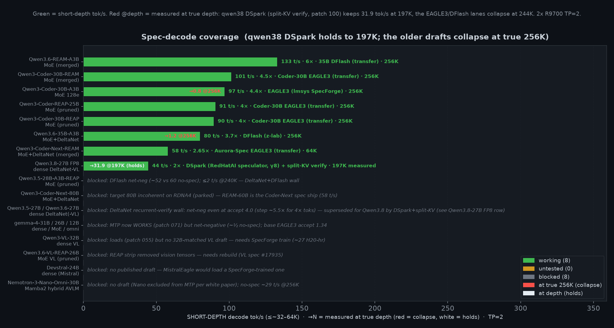
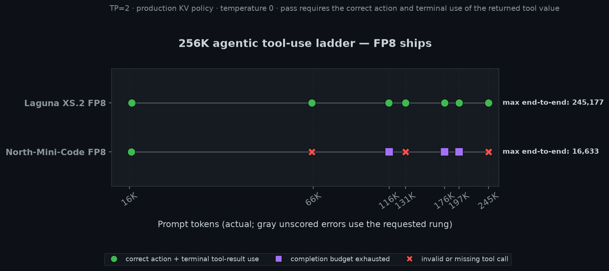
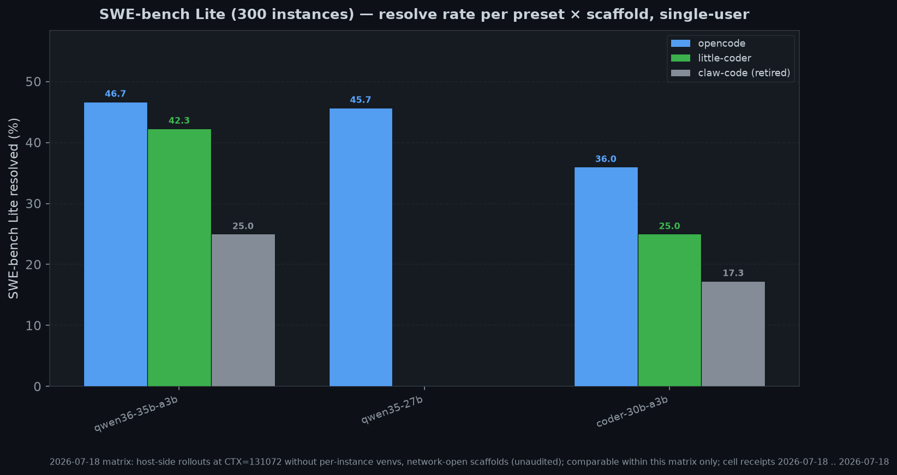

# RDNA4 inference on 2× R9700

SGLang v0.5.22 with 74 local RDNA4 patches, tuned for coherent single-user inference at long context
(256K) on two AMD Radeon AI PRO R9700 GPUs (gfx1201, 32 GiB each, TP=2 over PCIe). The repository holds
the patch series, the preset launcher, the benchmark and evaluation harnesses, the FP8/AWQ quantization
pipeline, and the receipts behind every number below. Multi-user throughput is secondary.

Serving tree `/data/sgl-v0522`, conda environment `sglang-triton36-v0522`, ROCm 7.2. The current focus
is FP8 inference for coding and agentic workloads: Cohere North-Mini Code, Poolside Laguna XS.2, and the
new quality flagship Qwen3.8-27B-FP8.

## Where things stand

- **Nineteen presets boot and serve** on one launcher (`scripts/launch.sh`); 16 of 17 swept presets emit
  parsed structured tool calls at boot (GLM-4.5 Air is receipted as not agentic-qualified).
- **Laguna XS.2 FP8 is the fleet-speed default**: 74.0 tok/s at 62 input tokens and 55.1 tok/s at 220K
  on the native Triton block-FP8 lane (36.8–47.8% over dequant-to-BF16), with a 21/21 seed-rung 256K
  agentic ladder. North-Mini Code passes the same ladder 21/21 to 245,172 actual tokens.
- **Qwen3.8-27B-FP8 is the quality flagship**: fleet-best LAB-Bench 42.3% (no-think multiple choice),
  MMLU 84.2%, HumanEval 93.3%, 7/7 agentic rungs to 245,150 actual tokens. Its preset is **DSpark
  speculative decoding** through the split-KV verify kernel (patch 100): **34.3 / 44.5 / 41.6 / 30.1 tok/s
  at 24 / 7.3K / 58K / 197K input** (canonical 3-run think-off sweep, v0.5.22, 2026-10-19) against
  22.5 / 22.2 / 21.4 / 20.0 on the no-spec server (`QWEN38_SPEC=0`, which keeps the 530K-token pool for
  true 256K work; the DSpark pool is 206K), 45.6 tok/s on thinking text at 58K, capability probe 5/5.
  Its seven-scaffold SWE-bench Lite bake-off (v5, 300 instances per cell, every scaffold sandboxed in
  the official instance image) has rolled and audited all 2,100 instances; Docker scoring is owed — see
  SWE-bench Lite below.
- **The patch series replays byte-identically** onto pristine v0.5.22 under the strict gate in
  [`patches/README.md`](patches/README.md).

## Results

### Single-user decode across the fleet





Every model runs under its production preset (quantization, graph policy, KV dtype). Curves are
regenerated by [`generate_charts.py`](scripts/bench/generate_charts.py) from each
`benchmarks/<model>/results.json` (three-run streaming-TPOT median, decode-only, actual input-token
counts). The table adds Laguna's current post-089 measurement (five runs, completion-token counted),
which is why its table row is above its plotted 074–082 curve. "Short" ≈ 128-token input; "Deep" is the
deepest measured input. Provenance, raw JSON, and per-model curves are under
[benchmarks/](benchmarks/README.md).

| Model | Class | Short tok/s (input) | Deep tok/s (input) |
|---|---|---:|---:|
| North-Mini-Code-1.0 | FP8 MoE + hybrid SWA | 71.8 (128) | 35.6 (197K) |
| Laguna-XS.2 | FP8 MoE + hybrid SWA | **74.0 (62)** | **55.1 (220K)** |
| Nemotron-3-Nano-Omni-30B | FP8 Mamba2 hybrid MoE | 95.6 (28) | 60.9 (198K) |
| Qwen3-Coder-30B-A3B | AWQ MoE | 88.3 (20) | 57.2 (29K) |
| Qwen3-Coder-REAP-25B-A3B | AWQ MoE | 89.5 (20) | 18.4 (197K) |
| Qwen3-Coder-Next-REAM-60B | AWQ MoE + DeltaNet | 48.6 (20) | 22.7 (110K) |
| GLM-4.5-Air-REAP | AWQ MoE | 25.7 (17) | 25.6 (27K) |
| Qwen3.5-28B-A3B-REAP | AWQ MoE + DeltaNet | 66.7 (22) | 21.1 (197K) |
| Qwen3.6-35B-A3B | AWQ MoE + DeltaNet | 67.0 (22) | 22.0 (197K) |
| Gemma 4 26B-A4B | AWQ MoE + SWA | 74.8 (25) | 58.3 (15K) |
| Devstral-24B | AWQ dense | 47.9 (15) | 23.0 (110K) |
| Devstral-Small-2-24B | AWQ dense + vision | 52.7 (15) | 17.0 (198K) |
| Qwen3.5-27B | AWQ dense + DeltaNet | 24.5 (22) | 11.2 (197K) |
| Qwen3.6-27B | AWQ dense + vision | 24.9 (22) | 11.5 (197K) |
| Qwen3.8-27B | official FP8 dense + DeltaNet (VL + video) | 22.5 (24) | **20.0 (197K)** |
| Qwen3-VL-32B | AWQ dense + vision | 23.4 (20) | 16.5 (27K) |
| Gemma 4 31B | AWQ dense + SWA | 29.4 (25) | 10.5 (110K) |
| Gemma 4 12B | AWQ omni + SWA | 38.6 (25) | 10.9 (198K) |

Gemma 4 26B-A4B caps near 16–30K in its current SWA configuration; the full Coder-Next-80B AWQ
checkpoint is pending (the REAM-60B variant is measured); GLM-4.5-Air runs eager and its short-context
points are noisy. Do not present a short prompt on a 256K-capable server as 256K-depth throughput.

#### Speculative decoding across the fleet



Only the Qwen3.8-27B DSpark lane (RedHatAI speculator through the split-KV verify kernel, patches
100; the DSpark boot fix that was 099 is upstream since v0.5.22) holds its gain at depth: 30.1 tok/s at 197K actual input against 20.0 no-spec (31.9 on v0.5.20). Every
EAGLE3/DFlash draft that wins at short depth collapses at true 256K (0.8–1.2 tok/s at 240–244K), so the
green bars are short-depth server capability, not 256K throughput. Data and per-lane notes:
[`benchmarks/specdecode.json`](benchmarks/specdecode.json).

### 256K agentic tool-use ladder



Seven rungs from 16K to ~245K actual prompt tokens, three seeds per model at the model's recommended
sampling, fixed 8,192-token budgets on both turns. Green requires the correct `BANANA42` action and
terminal semantic use of the `KIWI77` tool result **on every seed**; purple is completion-budget
exhaustion (excluded from the action-rate denominator); red is an invalid or missing primary tool call.
The chart is generated from the six schema-v2 seed receipts in
[`benchmarks/quality/`](benchmarks/quality/) and fails closed if the per-seed prompts are not
byte-identical. Qwen3.8-27B-FP8 has a single-profile receipt on the same schema
([JSON](benchmarks/quality/tooluse256k-qwen38-27b-fp8-v0518-r9700.json), 7/7 valid and correct to
245,150 tokens); it is not plotted because it is one profile, not the three-seed contract.

### SWE-bench Lite (official Docker harness)



The chart is regenerated by `generate_charts.py` from the per-cell receipts in
[`benchmarks/quality/bakeoff-*.json`](benchmarks/quality/) that
[`aggregate_bakeoff.py`](evals/swebench/aggregate_bakeoff.py) writes after Docker scoring; it only
holds the July matrix today and will pick up the Qwen3.8 v5 cells as they are scored, labelled with
their own harness line so the two matrices are never read as one.

**Qwen3.8-27B-FP8 v5** (rolled 2026-09-27 → 2026-10-30 on the DSpark preset at CTX=262144): seven lanes —
opencode, opencode-dcp, little-coder, little-coder-rtk, oh-my-pi (omp), prime-agent, deepagents-code (dcode) —
at 300/300 each, every scaffold inside the official per-instance SWE-bench image with no network, an opaque work
tree, the task prompt on stdin, a 32,000-token output cap on every wire (`OUTPUT_BUDGET`) and the `infra_*`
audit before scoring. The chain ended on 2026-10-31 with every cell audited clean (`infra_*` = 0); still owed before
publication: Docker scoring of the seven cells (the first cycle to reach that phase exited on a wrong script path,
fixed), the omp cell re-roll (its first roll split engines v0.5.20/v0.5.22 and ran
omp 18.0.11's title fork; it re-rolls on 18.12.2), and `audit_git_peek.py` on every lane (must be 0 exposed).
The dcode cell was re-rolled from zero on 2026-10-26 after its first 70 instances ran without an output cap;
the capped cell walls at 47% against 15–24% for the other lanes on the same ids (per-turn reasoning volume, not
runaway turns). The matrix will be published as its own dated page with the scaffold-disagreement table; the
bake-off's job is to catch hosting errors across scaffolds (server crashes, parser faults, `infra_*` cells),
not to rank engines. Lineage: v2 is an exposure study only — the agents reached the upstream fix through
future git history and the web on 45–61% of instances
([leak audit](benchmarks/quality/swebench-leak-audit-qwen38-v2.json)); v3/v4 were the sandboxed restarts that
fixed the output cap, the argv prompt delivery and the harness-owned benchmark cues; v4 (no-spec server,
opencode 300/300, opencode-dcp 159/300) stays on disk as the no-spec reference. Every restart decision and
audit is in [`evals/swebench/FP8_BAKEOFF_SETUP.md`](evals/swebench/FP8_BAKEOFF_SETUP.md).

Resolved rate per model × scaffold from the [2026-07-18 matrix](evals/swebench/bake-off-2026-07-18.md)
(host-side rollouts at CTX=131072 without per-instance venvs, 300 instances per cell; comparable within
the matrix only — its sessions were never audited for the git/web exposure channels, which were open to it):

| Model preset | opencode | little-coder | claw-code |
|---|:---:|:---:|:---:|
| `coder-30b-a3b` | 36.0% | 25.0% | 17.3% |
| `qwen35-27b` | 45.7% | — | — |
| `qwen36-35b-a3b` | 46.7% | 42.3% | 25.0% |

## Next steps

Ordered by what the GPUs do next. Specs with an ID live in [`experiments/`](experiments/README.md); the
operational history behind each item lives in the document it links, not here.

**Stopped, scoring owed**

- **Qwen3.8 bake-off v5** — all seven lanes rolled and audited clean; the chain ended 2026-10-31 without
  scoring (the GPUs went to the experiments queue). To finish: `bash
  /data/logs/run-model-cycle-logs/v5-resume-after-reboot.sh` at a free GPU slot re-runs the cycle with
  `--skip-existing` (rollouts skip, audit re-confirms 0 infra, Phase 5 scores in Docker, GPU-free apart
  from the audit's server boot; re-touch `v5-resume-armed` after it), then `kill -CONT` the omp re-roll
  waiter once `run_model_cycle.sh` is alive. Then `audit_git_peek.py` on every lane, publish the matrix
  with the scaffold-disagreement table and the v2 exposure study beside it.

**Next GPU slots, in order**

1. **Flint first boot** (`./scripts/launch.sh flint`, patch 105, FP8 build gated offline 2026-10-22): sink
   numerics against a torch reference, `validate_capabilities.py`, decode baseline at three depths, a
   natural-text haystack at 131K and 250K (the 3090's stock filler failed there), then its SWE-bench lane
   on the chosen scaffold.
2. **Residual qwen38 decode gap**: graphs are on (+26–33%, FINDINGS → HIP graphs); the gap to the ~25 ms
   bandwidth floor (~13.5 GB of FP8 weights per rank per step) is next — `profile_decode_step.sh` (FP8 M=1
   Triton block-GEMM) and `p2p_allreduce_bw.py` (custom all-reduce over PCIe Gen4 ×8);
   [R97-K](experiments/11-decode-rocblas-residue-attribution.md) attributes the rocBLAS residue.
3. **gfx1201 Triton W8A8 block-GEMM tuning for the dense FP8 path** ([R97-L](experiments/12-fp8-exact-shape-gemm-tuner.md)), the
   `N=17408,K=5120` analogue of patch 078's MoE tuning.
4. **LAB-Bench re-measure** of the suppressed Qwen3.5/Gemma4 cells with `--mc-no-think`
   (FINDINGS → LAB-Bench think-budget artifact).
5. **Agentic turn tax at depth** ([R97-J](experiments/10-extend-attention-kv-split-agentic-turn.md)): split the KV walk in extend attention; gate on
   numerical equivalence and no cold-prefill regression.
6. **256K ladder across the agentic-qualified fleet** ([R97-I](experiments/09-fleet-ladder-per-model-rungs.md)), including Nemotron's 2K/8K
   budget arms and the Devstral `KV_DTYPE` control.
7. **EAGLE3 drafts in the `--spec` lane, depth curve** ([R97-A](experiments/04-eagle3-dense-vl-spec-lane-depth-curve.md)).
8. **DeltaNet pool record** under `--max-running > 1` for every DeltaNet preset (recurrent state replicates
   per slot; `qwen38` pins `MAX_RUNNING=1`).

**Your decisions**

- dcode in the v5 matrix: keep its 29-minute wall (47% walls, same methodology as the other six) or add the
  3090's 60-minute wall as a separate cell.
- decode-topk promotion ([R97-B](experiments/07-decode-topk-promotion-brief.md)): 1.77× at 245K on a pre-v0.5.15 gate; needs regeneration.
- `ci-build-canary` (weekly image build) needs a push with a workflow-scoped token (refused 2026-10-25).
- [R97-H](experiments/08-bench-dir-hygiene-purge-or-remeasure.md) GPU half: `decode_ab` re-measure of `qwen3.6-ream-a3b-awq` and
  `qwen3.6-vl-reap-26b-a3b-awq` (~4 h) or purge them if the boot gate fails.

**Blocked**

- Qwen3.6-35B-A3B REAP prune ([R97-F](experiments/05-qwen36-35b-reap192-two-rig-relay.md), waiting on the 3090 handoff); North/Laguna canonical-eval
  cells ([R97-G](experiments/06-north-laguna-canonical-eval-ngram-rows.md) Phase B/C); post-FP8 concurrency re-measure ([R97-O](experiments/15-concurrency-hol-blocking-postfp8-remeasure.md)).

Notes and asks from the sister rigs are kept in [`CROSS-TEAM.md`](CROSS-TEAM.md), not here.

## Quick start

```bash
./scripts/setup.sh
./scripts/launch.sh north-mini
./scripts/launch.sh laguna

python scripts/eval/validate_capabilities.py --port 23334
bash scripts/bench/bench_256k_sweep.sh north-mini
```

Common overrides:

```bash
CTX=262144 MEM=0.90 PORT=23335 ./scripts/launch.sh laguna
MODEL=/path/to/checkpoint ./scripts/launch.sh qwen36-moe
ENV_NAME=other-env SGLANG_DIR=/path/to/sglang ./scripts/launch.sh coder-30b
GPU_IDS=0 TP=1 ./scripts/launch.sh coder-30b
ENABLE_OVERLAP_SCHEDULE=1 ./scripts/launch.sh laguna  # experimental scheduler A/B
```

The model checkpoint controls compressed-tensors FP8 detection. Presets supply the validated attention
backend, quantization path, parsers, memory settings, and graph policy.

## Current stack

| Component | Version |
|---|---|
| GPUs | 2× AMD Radeon AI PRO R9700, gfx1201, 32 GiB each |
| SGLang | v0.5.22 + 74 patches |
| Python | 3.12 |
| PyTorch | 2.11.0+rocm7.2 |
| ROCm | 7.2 |
| Triton | 3.6.0 |
| RCCL | 2.27.7 |
| transformers | 5.19.0 |

`/data/sgl-v0522` sits on the peeled commit `baa9befa3` of v0.5.22 (2026-10-13; v0.5.21 was skipped). Upstream
`main` is not tracked: the series and the native HIP kernel builds pin to release tags, and the next rebase
waits for the next tag and a bake-off boundary. v0.5.20 is retained at `/data/sgl-v0520` /
`sglang-triton36-v0520` as the rollback. Rebase procedure and per-version receipts:
[`patches/README.md`](patches/README.md).

TP=2 requires both kernel P2P support and IOMMU passthrough:

```bash
zcat /proc/config.gz | grep -E 'CONFIG_HSA_AMD_P2P|CONFIG_PCI_P2PDMA'
grep -o 'iommu=pt' /proc/cmdline
```

Required kernel settings are `CONFIG_HSA_AMD_P2P=y`, `CONFIG_PCI_P2PDMA=y`, and the boot argument
`iommu=pt`. `HSA_FORCE_FINE_GRAIN_PCIE=1` remains enabled but is not a substitute for those
requirements. Because `iommu=pt` reduces DMA isolation, use this configuration only on a dedicated host
with trusted workloads; GPU passthrough is not a safe multi-tenant sandbox.

### OCI image

`Dockerfile` builds the ROCm 7.2/v0.5.22 stack without a GPU; GitHub Actions promotes verified digests
to `ghcr.io/<owner>/sglang-rdna4`. The image is hardened for untrusted networks (keyed API, fail-closed
preset launcher, disabled remote code and media by default) and must still sit behind a private network
and an authenticating TLS proxy. Device selection, secrets, `docker run` recipes, the read-only
root-filesystem layout, and the full threat model are in [`docker/README.md`](docker/README.md).

## Supported presets

`scripts/launch.sh` is the source of truth for model paths and runtime flags.

| Preset | Model family | Primary lane | Context |
|---|---|---|---:|
| `north-mini` | North-Mini-Code-1.0 | FP8 MoE + hybrid SWA | 256K |
| `laguna` | Laguna-XS.2 | FP8 MoE + hybrid SWA | 256K |
| `flint` | RecursiveSI Flint (patch 105; GPU validation pending) | FP8 MoE + hybrid SWA + learned sinks | 262K |
| `coder-30b` | Qwen3-Coder-30B-A3B | AWQ MoE | 32K default; 256K capable |
| `coder-reap-25b` | Qwen3-Coder REAP 25B-A3B | AWQ MoE | 256K |
| `coder-next` | Qwen3-Coder-Next-80B | AWQ MoE + DeltaNet | 128K |
| `coder-next-ream` | Coder-Next REAM | AWQ MoE + DeltaNet | 128K |
| `devstral` | Devstral-24B | AWQ dense | model preset |
| `devstral2` | Devstral-Small-2-24B | AWQ dense + vision | 256K |
| `qwen35` | Qwen3.5-27B | AWQ/FP8 DeltaNet | 256K |
| `qwen35-moe` | Qwen3.5-35B-A3B | AWQ MoE + DeltaNet | 256K |
| `qwen36-27b` | Qwen3.6-27B | AWQ/FP8 DeltaNet + vision | 256K |
| `qwen38` | Qwen3.8-27B | official FP8 (block) DeltaNet + vision + video + DSpark draft | 206K pool on v0.5.22 (256K with `QWEN38_SPEC=0`) |
| `qwen36-moe` | Qwen3.6-35B-A3B | AWQ/FP8 MoE + DeltaNet | 256K |
| `qwen3vl-32b` | Qwen3-VL-32B | AWQ dense + vision | 256K override |
| `gemma4` | Gemma 4 26B-A4B | AWQ/FP8 MoE + vision | 256K |
| `gemma4-12b` | Gemma 4 12B Unified | AWQ multimodal | 256K |
| `gemma4-31b` | Gemma 4 31B | AWQ dense + vision | 256K override |
| `nemotron-omni` | Nemotron-3-Nano-Omni | FP8 Mamba2 hybrid MoE | 256K |
| `glm45-air` | GLM-4.5-Air REAP | AWQ MoE | 32K |

Additional fallback presets exist for Gemma 4 31B checkpoint formats; `./scripts/launch.sh -h` lists
everything.

## Runtime policy

- Use CUDA/HIP graphs for dispatch-bound MoE and recurrent hybrid presets; keep compute-bound dense
  presets eager unless an A/B shows a gain (qwen38 dense DeltaNet FP8 gained +26–33% on plain
  M=1 decode with identical outputs, so it runs graphs; see next steps).
- Use FP8 for native gfx1201 FP8 checkpoints and dense-thinking agentic workloads that lose quality
  under int4; use AWQ int4 for weight-bandwidth-bound single-user decode and for models that need the
  extra KV capacity.
- Use no speculative decoding at true 256K depth unless a same-depth A/B proves it. The first lane that
  does is `qwen38` + DSpark through the split-KV verify (patch 100, 2026-09-27): 1.6× / 2.0× / 1.5× / 1.6×
  at 24 / 7.3K / 58K / 197K input on the canonical sweep, so it is the preset default; its pool ends at
  206K on v0.5.22 (`QWEN38_SPEC=0` for the 256K no-spec server). Every other trained-draft lane still collapses at
  244K (FINDINGS → Speculative decoding).
- Treat tool-call and reasoning parsers as model-specific correctness settings, not optional
  presentation features.
- Keep the Triton cache warm when collecting comparative numbers.
- On gfx1201, decode `num_kv_splits` defaults to 64 (patch 086), not the AMD default of 16, so the
  flash-decode grid fills the 64 CUs at long context; override with `SGLANG_KV_SPLITS_OVERRIDE`.
- Native Triton dense block-FP8 is Laguna's default (36.8–47.8% over `auto`); roll back with
  `FP8_GEMM_BACKEND=auto ./scripts/launch.sh laguna`. Do not use the stock SGLang block-FP8 tuner on
  gfx1201: its unrolled search is not the production path and lacks the correctness gates Laguna's
  K=256 shape needs.
- Keep Laguna overlap scheduling off for single-user decode. `ENABLE_OVERLAP_SCHEDULE=1` is an
  experimental concurrency/shared-prefix A/B, not a proven deep-context default.

## Validation and quantization

Every new or modified ship must pass weight and scale integrity, basic generation, the applicable
reasoning/tool-call/image/video/audio probes, long-context coherent generation, and a same-method
performance baseline:

```bash
python scripts/eval/check_awq_scales.py /path/to/awq --base /path/to/bf16
python scripts/eval/validate_capabilities.py --port 23334
bash scripts/quantize/run_full_pipeline.sh qwen35   # full AWQ pipeline, base check included
```

The AWQ base comparator distinguishes benign zero scales over dead MoE channels from zero scales over
live weights. Build `mattbucci/*` releases from the upstream BF16 checkpoint with the repository's own
calibration and pruning scripts; community quantizations are reference data, not release inputs.

## Known limitations

- Long-running TP=2 harnesses can expose one-rank stalls that short serving probes do not. Use the
  watchdog and capture scheduler stacks on recurrence.
- Back-to-back TP=2 relaunches intermittently hit an RCCL-init GPU coredump (rank exit -6): a hard kill
  leaks the communicator's `/dev/shm` IPC segments and a fast relaunch faults on a stale one. Run
  `bash scripts/free_gpu.sh` between serving runs.
- Coder-Next full-size and GLM-4.5-Air remain diagnostic presets rather than recommended agentic ships;
  Qwen3-Coder-30B REAM is research-only until it passes a same-scaffold quality comparison against the
  unmerged checkpoint.
- Gemma 4 31B vision and video are non-functional on the local `gemma-4-31B-AWQ` checkpoint: it carries
  no `vision_tower.*` weights (the tower is randomly initialized at load, on every SGLang version), so the
  probe answers are hallucinated; use the 12B or 26B Gemma presets for multimodal workloads.
- Verbatim needle recall at ~198K is at the boundary for the two recurrent/windowed presets, on every
  engine version: nemotron-omni greedily returns the planted values' digits without their alpha prefix
  (`MID=2291 LATE=7734`, byte-identical on v0.5.18 and v0.5.20, full-form to 88K) and north-mini answers
  not-found; a single T=0.7 sample on either lands on either side of that boundary, so fleet-run LATE flips on
  these two presets are not regressions
  ([controls](benchmarks/validation/deep-probe-controls-v0518-v0520-2026-09-19.json)).
- North-Mini-Code's previous ~120K recall ceiling is withdrawn: it was measured under incorrect
  centered-LayerNorm semantics and partly without checkpoint KV scales. Served correctly (patches
  090–095) it shows no agentic ceiling below 262,144. The pre-fix curve in
  [flagship-recall-depth-2026-07-16.md](benchmarks/flagship-recall-depth-2026-07-16.md) is a superseded
  incident record.
- Dense Qwen3.5/3.6 int4 checkpoints are throughput options; FP8 is the preferred agentic format.
- Devstral tokenization requires patch 083 so rendered `[INST]` and `[TOOL_CALLS]` markers remain
  single special tokens.
- Do not use DCP2 with the TP2 GQA coding presets: adjacent ranks hold distinct K/V heads while the DCP
  MHA reduction requires replicated K/V heads inside each group; North/Laguna also lack hybrid-SWA DCP
  support.
- **Agentic turns at depth are prefill-bound, not decode-bound** (Laguna, 2026-07-19): appending a
  short suffix to a cached prefix pays a tax proportional to prefix length — 604.6 ms of TTFT at
  176,588 cached tokens for one token, 607.7 ms for 64 — because the extend grid
  (`extend_attention.py:63`) collapses to ~24 workgroups per rank on a short suffix while decode
  splits the same walk 64 ways. Fit: `TTFT_ms ≈ 32.7 + 3.226 per 1000 cached tokens`. Tracked as
  [R97-J](experiments/10-extend-attention-kv-split-agentic-turn.md); North-Mini untested.
- The AWQ M=1 decode GEMV under-fills the 64 CUs on narrow-output projections (attn_o ~33–52% of
  roofline). Grid-level split-K was implemented and **refuted** — it regresses; the cap is per-CU
  wavefront occupancy, not block count. Details:
  [dense-gemv-narrow-n-splitk-handoff.md](benchmarks/dense-gemv-narrow-n-splitk-handoff.md).

Final experiment dispositions are summarized in [benchmarks/FINDINGS.md](benchmarks/FINDINGS.md).

## Repository map

| Path | Purpose |
|---|---|
| [scripts/](scripts/README.md) | setup, launch, benchmark, evaluation, quantization, and test entry points |
| [patches/](patches/README.md) | ordered SGLang v0.5.22 patch series and the replay gate |
| [PATCHES.md](PATCHES.md) | cross-environment patch inventory |
| [benchmarks/](benchmarks/README.md) | current results, raw JSON, charts, and consolidated findings |
| [evals/swebench/](evals/swebench/FP8_BAKEOFF_SETUP.md) | SWE-bench Lite bakeoff harness, audit, and Docker scoring |
| [experiments/](experiments/README.md) | vetted experiment specs and the execution queue |
| [docker/](docker/README.md) | OCI image build, hardening, and run recipes |
| [CROSS-TEAM.md](CROSS-TEAM.md) | inbox for sister-rig notes and asks |
| [rules-for-agents.md](rules-for-agents.md) | operational and calibration invariants |
| [CLAUDE.md](CLAUDE.md) | concise repository working instructions |
