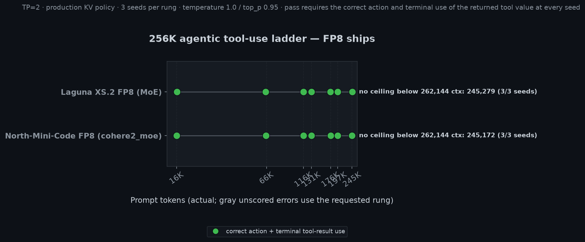
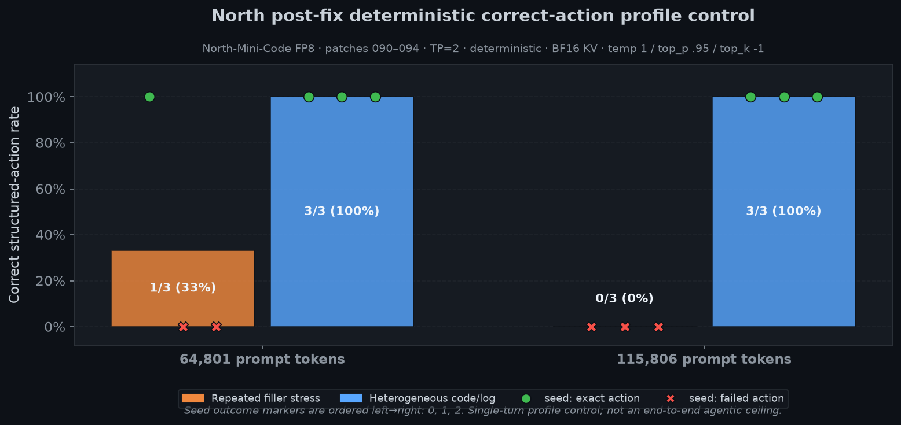

# Benchmarks

Measurements for tensor-parallel inference on two AMD Radeon AI PRO R9700 GPUs (gfx1201). Results are
only comparable when the model, SGLang stack, context depth, graph mode, quantization, and measurement
method match.

## Results by campaign

The whole servable fleet was measured on the 2026-07-12 v0.5.15 + patches 074–082 campaign tree with one
consistent method: streaming-TPOT median (3 runs, decode-only, actual input-token counts), ROCm 7.2, TP=2,
each model under its production launch preset (quant, graph policy, and KV dtype per preset). The full
decode table is in the [top-level README](../README.md#single-user-decode-across-the-fleet); each `<model>/` directory
here holds that model's `results.json` and regenerated `context_vs_toks.png` / `concurrency_vs_toks.png`.
Fleet charts regenerated from the same files by `scripts/bench/generate_charts.py`:
[all_models_decode.png](all_models_decode.png) (short vs deepest measured input per model),
[all_models_context.png](all_models_context.png) (decode vs context), [specdecode_fleet.png](specdecode_fleet.png)
(from [specdecode.json](specdecode.json)), and [bakeoff_swebench_lite.png](bakeoff_swebench_lite.png)
(SWE-bench Lite resolve rate per preset × scaffold from `quality/bakeoff-*.json`; cells carry a `harness`
line so matrices run under different harnesses are labelled, never merged).

### Qwen3.8-27B-FP8 (2026-11-11, v0.5.22 + 98 patches, HIP graphs on, DSpark speculative preset)

Official vendor block-FP8 ship under the `qwen38` preset (TP=2, FP8-e4m3 KV, `MAX_RUNNING=1`,
`--cuda-graph-max-bs-decode 1`, `--speculative-algorithm DSPARK` with the RedHatAI speculator (γ=8,
sliding-window draft, converted by `scripts/convert_dspark_speculators_config.py`) through the split-KV
verify kernel (patch 100), `mem 0.88`, `chunked-prefill 4096`, TP-split DeltaNet projections (patch 121), one-row
decode kernels (patches 122–124), GQA-grouped verify prefix stage (patch 125), windowed draft layers through the
split-KV stage (patch 126), W8A16 GEMM for the verify rows (patch 128), in-graph custom all-reduce (patch 129), BF16 wire for the two-rank
attention sum (patch 130)).
Canonical decode sweep (`decode_ab`, 5-run streaming-TPOT median, think-off, EOS;
[qwen38-27b-fp8/results.json](qwen38-27b-fp8/results.json)); the no-spec server (`QWEN38_SPEC=0`, mem 0.85,
732,790-token pool) is the reference curve in
[qwen38-27b-fp8-nospec/results.json](qwen38-27b-fp8-nospec/results.json):

| Actual input tokens | 24 | 7,331 | 58,483 | 197,326 |
|---|---:|---:|---:|---:|
| **Decode tok/s, DSpark, patches 121–130 (preset default, 2026-11-11)** | **60.675** | **80.951** | **74.495** | **60.555** |
| Decode tok/s, no-spec, same tree (2026-11-11, reference) | 35.594 | 34.876 | 33.291 | 29.854 |
| Speed-up (DSpark vs no-spec, 2026-11-11) | 1.70× | 2.32× | 2.24× | 2.03× |
| Decode tok/s, DFlash2 comparison drafter, same tree (2026-11-11, not a preset) | 80.564 | 78.368 | 71.373 | 58.189 |
| Decode tok/s, DFlash2 comparison drafter on RCCL (`ENABLE_CUSTOM_ALL_REDUCE=0`), same tree | 79.520 | 77.599 | 70.615 | 57.748 |
| Decode tok/s, DSpark, patches 121–129 (2026-11-10) | 59.628 | 79.822 | 73.089 | 59.471 |
| Decode tok/s, no-spec, patches 121–129 (2026-11-10) | 35.022 | 34.320 | 32.744 | 29.181 |
| Decode tok/s, DFlash2 comparison drafter, patches 121–129 (2026-11-10) | 79.059 | 76.986 | 69.983 | 57.359 |
| Decode tok/s, DSpark, patches 121–126 (2026-11-10) | 50.844 | 72.459 | 66.800 | 50.720 |
| Decode tok/s, no-spec, patches 121–126 (2026-11-10) | 34.264 | 33.560 | 32.115 | 28.681 |
| Decode tok/s, DFlash2 comparison drafter, patches 121–126 (2026-11-10) | 65.478 | 76.084 | 70.163 | 71.912 |
| Decode tok/s, DSpark, patches 121–124 (2026-11-10) | 51.051 | 63.740 | 55.892 | 35.672 |
| Decode tok/s, no-spec, patches 121–124 (2026-11-10) | 34.270 | 33.615 | 32.129 | 28.715 |
| Decode tok/s, DSpark, TP-split DeltaNet (2026-11-09) | 47.175 | 57.851 | 38.705 | 33.311 |
| Decode tok/s, no-spec, TP-split DeltaNet (2026-11-09) | 26.711 | 26.313 | 25.355 | 23.230 |
| Decode tok/s, DSpark, replicated DeltaNet (2026-11-01) | 44.914 | 52.233 | 47.465 | 41.009 |
| Decode tok/s, DSpark + split-KV verify, v0.5.22 (2026-10-19) | 34.326 | 44.526 | 41.594 | 30.058 |
| Decode tok/s, DSpark + split-KV verify, v0.5.20 (2026-09-27) | 35.493 | 44.512 | 31.631 | 31.874 |
| Decode tok/s, no-spec (2026-09-19 canonical) | 22.543 | 22.227 | 21.438 | 19.955 |

Receipts: [DSpark](qwen38-27b-fp8/decode-canonical-dspark-2026-11-11-98p.json),
[no-spec](qwen38-27b-fp8/decode-canonical-nospec-2026-11-11-98p.json),
[DFlash2](qwen38-27b-fp8/decode-canonical-dflash2-2026-11-11-98p.json),
[DFlash2 on RCCL](qwen38-27b-fp8/decode-canonical-dflash2-rccl-2026-11-11-98p.json); cold prefill at 7.3K / 58K / 197K is
2,720 / 1,996 / 1,138 tok/s on the DSpark server and 2,779 / 2,035 / 1,155 without speculation (173.3 s and 170.9 s at
197K; the 97-patch sweep read 2,279 / 1,748 / 1,056 and 2,334 / 1,785 / 1,072)
([DSpark](qwen38-27b-fp8/prefill-canonical-dspark-2026-11-11-98p.json),
[no-spec](qwen38-27b-fp8/prefill-canonical-nospec-2026-11-11-98p.json)), capability probe 5/5 on the three speculative
servers ([DSpark](qwen38-27b-fp8/capabilities-canonical-dspark-2026-11-11-98p.json),
[DFlash2](qwen38-27b-fp8/capabilities-canonical-dflash2-2026-11-11-98p.json),
[DFlash2 on RCCL](qwen38-27b-fp8/capabilities-canonical-dflash2-rccl-2026-11-11-98p.json)), greedy route probe 10/10 on
all four servers, the concurrent-request case included (`route-canonical-<arm>-2026-11-11-98p.json`). The DFlash2 rows
are the third-party tcclaviger FP8 drafter radiance serves, a comparison input. Its cold first runs, the cells the
radiance gap table uses, read 81.2 / 77.9 / 59.6 / 57.7 on 80 / 38 / 47 / 37 completion tokens, radiance's own
counts; the repeats at 58K decode a 46-token continuation at 71.4 (the patches 121–129 sweep: cold runs 79.3 / 76.8 /
58.7 / 56.8 on the same token counts; the patches 121–126 sweep: 65.7 / 75.6 / 67.7 / 52.0 with 46 tokens at 58K,
repeats at 197K on a 46-token continuation). The custom all-reduce and RCCL DFlash2 servers decode the same token
counts on every run and read ×1.013 / ×1.010 / ×1.011 / ×1.008 for the custom path, so the preset default also holds
behind this drafter. A DSpark rate is draft-and-verify cycles per
second times accepted tokens per cycle, and the second factor follows the continuation a run lands on: the
2026-11-01 deep medians sat on a 45-token continuation, the 2026-11-09 ones on 47 and 37 tokens, the later ones
on 33 and 37, so the DSpark rows of different days do not compare kernels (FINDINGS → RAD-1). The 2026-11-10
DSpark rows of patches 121–124 and 121–126 share their 80 / 38 / 33 / 37-token continuations and do: +14 % / +20 % /
+42 % at 7.3K / 58K / 197K from the verify prefix stage and the windowed draft stage (patches 125–126), −0.4 % at 24
tokens. The patches 121–129 row sits on the same four continuations: +17.3 % / +10.2 % / +9.4 % / +17.3 % from the verify-row GEMM (patch
128) and the in-graph all-reduce (patch 129). The patches 121–130 row sits on them too: +1.8 % / +1.4 % / +1.9 % /
+1.8 % from the BF16 attention-sum wire (patch 130), with cold prefill time ×0.84 / ×0.88 / ×0.93. The no-spec rows compare throughout: +13–16 % from the layout (patch
121), then +24–28 % from the one-row decode kernels (patches 122–124), then +1.7–2.3 % from the all-reduce (patch 129), then +1.6–2.3 % from the wire (patch 130).
The pool is 428,579 tokens on the DSpark server (430,725 with the all-reduce on RCCL, 206,324 on the replicated
layout).

Thinking on (same v0.5.22 server, 3-run): 44.3 tok/s at 64 input tokens, 55.4 at 58,523 (v0.5.20: 34.5 and
45.6). Accept length 2.9–3.5 on the synthetic sweep text, 2.6–3.4 on code and summaries. The draft weights
and draft KV pool cap `max_total_num_tokens` at 206,324 on v0.5.22 (239,384 on v0.5.20; upstream's pool
sizing keeps ~0.45 GB/rank more headroom) at mem 0.88, and the aux-hidden-state capture adds a prefill transient, so
mem 0.90 OOMs in decode and 0.88 OOMs a 58K prefill at chunk 8192 — 0.88 + chunk 4096 is the validated
pair. Depth-ladder receipts behind the preset change: [dspark-depth-ab-2026-09-27.json](qwen38-27b-fp8/dspark-depth-ab-2026-09-27.json)
(stock verify: 5 tok/s at 49K) and [dspark-splitkv-depth-ab-2026-09-27.json](qwen38-27b-fp8/dspark-splitkv-depth-ab-2026-09-27.json).
The graphs-off 2026-08-30 v0.5.18 sweep the no-spec row replaced:
| Decode tok/s, v0.5.18 graphs off (2026-08-30) | 16.698 | 16.684 | 16.555 | 16.611 |

Still the strongest dense-class deep rate on the fleet, now +35/+33/+29/+20% over the graphs-off
curve. Graphs were enabled after the 2026-09-19 same-server HIP-graph A/B on v0.5.18
([graph-ab-2026-09-19.json](qwen38-27b-fp8/graph-ab-2026-09-19.json), 3 runs/point, idle CPU,
server restarted between arms: 22.5 / 22.2 / 21.6 / 20.2 tok/s at 24 / 6,563 / 52,193 / 176,044
actual input tokens, byte-identical temp-0 outputs, 5/5 capability probe); the v0.5.20 promotion run
reproduced that arm to within 0.1 tok/s at the same depths before the 2026-09-27 canonical sweep
([validation](../patches/v0520-rebase-2026-09-19.md)). The table above is the 2026-10-19 re-measurement on
v0.5.22 ([decode-v0522-canonical-2026-10-19.json](qwen38-27b-fp8/decode-v0522-canonical-2026-10-19.json));
the v0.5.20 rows (35.5 / 44.5 / 31.6 / 31.9 tok/s at the same actual inputs) are kept in `results.json`
under `previous_context_sweep_v0520_2026_09_27`, and the same-day A/B is in the
[v0.5.22 receipt](../patches/v0522-rebase-2026-10-19.md). A think-on sweep of the same server
([decode-v0522-thinking-2026-10-19.json](qwen38-27b-fp8/decode-v0522-thinking-2026-10-19.json),
44.3 / 45.5 / 55.4 / 45.4 tok/s) measures reasoning-text decode, where the speculator accepts more, and is
not the canonical row.
[Quality receipt](quality/Qwen3.8-27B-FP8.json): MMLU **84.2%** (100), HumanEval **93.3%** (30),
Needle 2/2, LAB-Bench **42.3%** overall (25/benchmark, fleet-best; measured with
`--mc-no-think`, i.e. `chat_template_kwargs.enable_thinking=false`). The earlier think-mode
LAB-Bench pass scored 5.1% because the 1024-token MC budget was consumed inside `<think>`
(empty content scored wrong); it is preserved in the receipt as `labbench_think_budget1024`, and
`mc_mode` records the per-benchmark condition. The same artifact suppressed the Qwen3.5 and Gemma 4
cells; their `--mc-no-think` re-measures are the `quality/*-nothink.json` receipts (Qwen3.5-27B LAB-Bench
0.405, Qwen3.5-28B-A3B-REAP 0.363, Gemma 4 31B 0.405, Gemma 4 26B-A4B 0.327; FINDINGS → LAB-Bench
think-budget artifact). HumanEval has two conditions: raw `/v1/completions` on the function stub (the
historical cells) and `--humaneval-chat` through the chat template (`he_mode: chat`; Gemma 4 scores 0/30 on the
stub and 30/30 / 29/30 through the template). `quality/quality_comparison.png` is regenerated from every
result file and labels chat-condition bars `[HE chat]`. The
[single-profile 256K agentic ladder receipt](quality/tooluse256k-qwen38-27b-fp8-v0518-r9700.json)
passes 7/7 rungs valid+correct to 245,150 actual tokens (`valid_toolcall` 1.0, `correct_action` 1.0).

DSpark speculative decoding on the same preset ([dspark-depth-ab-2026-09-27.json](qwen38-27b-fp8/dspark-depth-ab-2026-09-27.json), 2026-09-27, greedy, 2 runs/arm, fresh cache): 93–97 tok/s at a 60-token input (4.3× no-spec, byte-identical output), 45 tok/s with thinking on, 5.0–5.4 tok/s at 49K (0.24×), 244K unservable at `mem 0.85`; disposition in [FINDINGS.md](FINDINGS.md) → Speculative decoding. With the split-KV verify kernel enabled on gfx1201 (patch 100, [dspark-splitkv-depth-ab-2026-09-27.json](qwen38-27b-fp8/dspark-splitkv-depth-ab-2026-09-27.json)) the RedHatAI draft is net positive from 49K up: 32.1 tok/s at 49K (1.52×), 24.6 at 150K (1.22×), 60 tok/s on thinking text at short context.

North-Mini and Laguna additionally have a historical 074–082 A/B optimization campaign with correctness
scoring. North's row predates patch 090 and is retained for performance provenance, not current quality:

| Model | Input tokens | Decode tok/s | Correctness |
|---|---:|---:|---|
| [North Mini Code FP8, pre-090](north-mini/) | 128 / 29,357 / 117,048 / 219,352 | 71.053 / 60.714 / 42.298 / 33.905 | Historical 34/36; tool call passed |
| [Laguna XS.2 FP8](laguna-xs2/) | 62 / 7,403 / 58,785 / 220,277 | 48.999 / 47.485 / 39.959 / 29.270 | 34/36; capabilities 2/2; tool call passed |

See the historical [v0.5.15 receipt](north-laguna-v0515-r9700-2026-07-12.md) and its
[structured data](north-laguna-v0515-r9700-2026-07-12.json) for configuration, A/B controls, and test
counts.

### vllm-radiance parity (2026-11-08, RAD-0)

[magiccodingman/vllm-radiance](https://github.com/magiccodingman/vllm-radiance) (vLLM 0.30 + libr4d gfx1201 kernels) and
this stack, same cards and model files, both methodologies (BetterBench v0.2.2 `standard.json` at 8K; the canonical
think-off sweep at 256K), gates on every arm — [radiance-parity/README.md](radiance-parity/README.md). Non-spec FP8 decode
1.5× on radiance at every depth and concurrency (per step 28 vs 44 ms), prefill 2.2–2.7×, DFlash2 K7 91 tok/s at 197K
against DSpark 41 and in-checkpoint MTP 24; AMD's Quark MXFP4 W4A8 (comparison input) 1.35–1.46× over FP8 and 164 tok/s
at 197K with DFlash2. Disposition in [FINDINGS → vllm-radiance parity](FINDINGS.md#vllm-radiance-parity). The same Quark
checkpoint served here on the patch-117 Triton W4A8 path decoded at FP8 parity with prefill 3× slower
([receipts](profiling/mxfp4-serving-2026-11-09/), [kernel](profiling/mxfp4-w4a8-kernel-2026-11-09.json)) while its MLP was
replicated per rank; TP-split (patch 120) it decodes 29.9 / 29.6 / 28.0 / 25.2 tok/s at 24 / 7.3K / 58K / 197K against
23.2 / 22.8 / 21.9 / 20.2, split → replicated → split in one session
([receipts](profiling/rad11-mxfp4-mlp-split-2026-11-09/), [FINDINGS → RAD-11c](FINDINGS.md)); with the DeltaNet
projections split as well (the preset default for `QUANT_OVERRIDE=quark`) 34.3 / 33.6 / 31.8 / 28.4 and a cold prefill
of 958 / 854 / 646 tok/s against 800 / 728 / 572
([receipts](profiling/rad1-mxfp4-deltanet-split-2026-11-09/), [FINDINGS → RAD-1b](FINDINGS.md)).
Kernel-level comparison with libr4d 0.5.0 on the Qwen3.8 per-rank shapes, cold weight rotation, vendor library inside a
network-less sandbox (`scripts/bench/libr4d_sandbox.sh`, `libr4d_kernel_bench.py`, `libr4d_kernel_bench_summary.py`): the six
M=1 block-FP8 linears cost 24.5 ms per rank per step on the vendor W8A16 GEMV against 27.0–27.8 here
([receipts](profiling/libr4d-kernel-bench/)). Launch census of one graphed decode step from the profiler traces
(`scripts/bench/launch_census.py`, per-linear medians by launch position from `linear_by_position.py`): 2,657 launches per
rank on FP8
([FP8](profiling/rad11-profile-fp8-2026-11-09/), [MXFP4, replicated MLP](profiling/rad11-profile-mxfp4-2026-11-09/)).
Native W8A16 GEMV for the one-row block-FP8 linears (patch 122, opt-in), off → on → off in one session without speculation:
decode 26.7 / 26.2 / 25.3 / 23.2 → 28.9 / 28.4 / 27.4 / 24.9 tok/s, prefill and DSpark unchanged; `scripts/bench/bench_fp8_gemv_hip.py`
is its exactness and timing bench ([receipts](profiling/rad22-fp8-gemv-2026-11-09/), [FINDINGS → RAD-22](FINDINGS.md)).
`GemmaRMSNorm` on the one-launch Triton kernels (patch 123, opt-in), same design: decode 26.7 / 26.3 / 25.2 / 23.2 →
30.2 / 29.7 / 28.4 / 25.6 tok/s, cold prefill 2,123 / 1,658 / 1,025 → 2,316 / 1,783 / 1,072 tok/s, DSpark +17.7 % at 24 tokens
([receipts](profiling/rad5a-gemma-rmsnorm-2026-11-09/), [FINDINGS → RAD-5a](FINDINGS.md)). One-launch bf16 GEMV for the DeltaNet
`in_proj_ba` (patch 124, opt-in), same design: decode 26.7 / 26.3 / 25.3 / 23.1 → 27.5 / 26.9 / 26.3 / 23.8 tok/s, prefill unchanged,
DSpark cycle 1.1 ms shorter ([receipts](profiling/rad23-ba-gemv-2026-11-09/), [FINDINGS → RAD-23](FINDINGS.md)). Low-bit LM-head study on
4,873 captured head inputs (`scripts/bench/lm_head_capture.py`, `lm_head_lowbit_study.py`): an int8 copy with a proven candidate window
and an exact rerank costs 1.14 ms per rank against 2.55 for the bf16 head; 4-bit windows are statistical only
([receipt](profiling/rad15-lm-head-study-2026-11-10/study.json), [FINDINGS → RAD-15 study](FINDINGS.md)). The int8 head for greedy
requests (patch 127, opt-in; `scripts/bench/bench_lm_head_int8_hip.py`, `scripts/eval/greedy_route_probe.py`), both boot orders with a
plumbing-only arm: filter 1.10 ms per rank against 2.55, canonical no-spec decode 34.4 / 33.6 / 32.1 / 28.8 → 35.3 / 34.4 / 32.7 / 29.2
tok/s with the control's greedy text on 56 outputs, sampled requests unchanged, KV pool 735,510 → 692,246 tokens
([kernel](profiling/rad15-lm-head-kernel-2026-11-10/kernel-bench.json), [serving](profiling/rad15-lm-head-serving-2026-11-10/),
[FINDINGS → RAD-15](FINDINGS.md)). GQA-grouped verify prefix stage
(patch 125, FP8 `qwen38` preset default), two boots per side in one session: DFlash2 cycle 74.8 → 57.1 ms and DSpark 85.0 → 67.2 ms at 197K
input, −5–6 % at 58K, +1–2 % below 8K, needle 9/9 and capabilities 5/5 ([kernel](profiling/rad27-verify-gqa-kernel-2026-11-10/),
[serving](profiling/rad27-verify-gqa-serving-2026-11-10/), [FINDINGS → RAD-27](FINDINGS.md)); `scripts/bench/spec_cycle_report.py` reads cycle time,
accept length and timed stages from a slice of a server log. DSpark windowed draft layers through the split-KV stage (patch 126, FP8 `qwen38`
preset default): cycle 59.1 → 51.7 ms at 7.3K, 61.1 → 53.7 at 58K, 67.3 → 59.9 at 197K, −1.7 % at 24 tokens, greedy accept length ×0.991 over
24 paired prompts (`scripts/bench/spec_accept_probe.py`, verify count per request)
([kernel](profiling/rad28-draft-window-kernel-2026-11-10/), [serving](profiling/rad28-draft-window-serving-2026-11-10/), [FINDINGS → RAD-28](FINDINGS.md)). Verify launch census
(`scripts/bench/launch_census.py --span`, eager, target verify against a plain step at 24 and 58K tokens): 1,538 against 1,061 launches per
pass per rank, the nine-row block-FP8 GEMM with its quantiser is +5.4 / +6.8 ms of the verify's 10–14 ms over a plain step
([receipts](profiling/rad22b-verify-census-2026-11-10/), [FINDINGS → RAD-22b](FINDINGS.md)). W8A16 WMMA GEMM for 2–32 rows
(patch 128, FP8 `qwen38` preset default; `scripts/bench/bench_fp8_gemm_bf16_hip.py`): 24.1 → 20.8 ms per forward per rank at nine rows
with cold weights, DSpark cycle 50.8 / 51.7 / 53.8 / 59.9 → 46.9 / 47.6 / 49.7 / 56.0 ms at 24 / 7.3K / 58K / 197K in both boot orders,
canonical sweep 50.8 / 72.3 / 66.7 / 50.7 → 58.9 / 78.8 / 72.3 / 59.0 tok/s, greedy accept length ×0.995 over 24 paired prompts, needle
9/9 and capabilities 5/5 ([kernel](profiling/rad29-gemm-bf16-kernel-2026-11-10/), [serving](profiling/rad29-gemm-bf16-serving-2026-11-10/),
[FINDINGS → RAD-29](FINDINGS.md)). `scripts/bench/dspark_cycle_times.py`
reads DSpark cycle time and accept length from a server log; `scripts/bench/copyheavy_multi_bench.py` is the five-target
copy-heavy probe with decode-only timing. Accept controls on the shipped preset: the verify-row GEMM against its restore knob
over 48 mid-depth greedy documents, accept length ×1.003 ([receipts](profiling/rad29b-shipped-accept-2026-11-10/),
[FINDINGS → RAD-29b](FINDINGS.md)), and six boots of one probe: greedy speculative output repeats to the token on equal request
history, 9 of 48 texts when one boot runs the sampled ladder first, patch 129 against RCCL 48 of 48
([receipts](profiling/rad29c-greedy-repeat-2026-11-10/), [FINDINGS → RAD-29c](FINDINGS.md)).
The same GEMM behind the DFlash2 drafter, five boots in both orders: cycle 46.5 / 48.5 / 50.7 / 56.8 → 42.3 / 44.1 / 46.3 / 52.5 ms
at 24 / 7.3K / 58K / 197K, greedy accept length ×0.999 over 48 documents, the cycle is 1.46–1.52× the plain step of the same
session; `scripts/bench/spec_decode_rows.py` pairs each canonical row's streamed rate with the verify count of an unstreamed
repeat, which splits a speculative cell into accept length and cycle
([receipts](profiling/rad29d-dflash2-lane-2026-11-11/), [FINDINGS → RAD-29d](FINDINGS.md)).
Upstream's one-stage HIP all-reduce against RCCL on the FP8 preset: +1.8 % at 24 tokens with wrong sums, so RCCL stays
([receipts](profiling/rad2-onestage-ar-2026-11-09/), [FINDINGS → RAD-2](FINDINGS.md)); `scripts/bench/custom_allreduce_isolation.py`
drives the same class from two bare ranks and names what each output is: wrong with the PyTorch-pool staging buffer, exact
with an uncached fine-grained one ([receipt](profiling/rad2-onestage-ar-2026-11-09/custom-allreduce-isolation.json)).
Patch 129 allocates that staging buffer uncached on a PCIe-linked group and leaves inputs that do not fit it on RCCL
(FP8 `qwen38` preset default; `scripts/bench/allreduce_rows_ladder.py`: 10.8 / 22.3 / 32.2 / 58.9 µs per reduction against
RCCL's 17.8 / 29.5 / 38.9 / 61.2 at 1 / 9 / 16 / 32 rows in a captured graph, exact sums): two boots per side in both orders,
no-spec canonical sweep 34.3 / 33.7 / 32.1 / 28.7 → 35.0 / 34.4 / 32.7 / 29.2 tok/s at 24 / 7.3K / 58K / 197K with identical
greedy text, DSpark cycle 46.9 / 47.6 / 49.8 / 56.0 → 46.4 / 47.1 / 49.3 / 55.5 ms, greedy accept length unchanged over 24
paired prompts, needle 9/9, capabilities 5/5, VRAM growth within 2 MiB per card
([receipts](profiling/rad25-custom-ar-serving-2026-11-10/), [FINDINGS → RAD-25](FINDINGS.md)).
`scripts/bench/allreduce_wire_equality.py` sends every pair of BF16 bit patterns through RCCL and the custom path on two bare
ranks and compares the BF16 sum with the FP32 detour of the attention-TP sum bit for bit: no unequal pattern in 9.28 G + 4.71 G
pairs per rank; the detour costs 16.40 against 7.83 ms per reduction at 8192 rows and 16.4 against 9.6 µs at one row in a graph
([receipt](profiling/rad30-wire-equality-2026-11-11/allreduce-wire-equality.json), [FINDINGS → RAD-30 phase 0](FINDINGS.md)).
In serving the BF16 wire returns the same greedy tokens on every comparison of eight boots and takes 0.49 / 4.05 / 13.1 s off
the cold prefill at 7.3K / 58K / 197K (×0.84 / ×0.88 / ×0.93), with no-spec decode +1.2–1.7 % and the DSpark cycle ×0.98
([receipts](profiling/rad30-bf16-wire-serving-2026-11-11/), [FINDINGS → RAD-30 phase 1](FINDINGS.md)).
Cold prefill split by depth from the server's own chunk reports (`scripts/bench/prefill_chunk_curve.py`: chunk seconds against
prefix depth per chunked prompt of a server log, no profiler): 3.48 s per 8192-token chunk plus 0.0438 s per 1K of prefix, so
the 197K cold prompt is 83.8 s depth-free and 99.7 s depth-bound and the 58K one 25.0 + 7.8 s; the prefix attention runs
2.99 G (query, key) pairs/s per card
([receipts](profiling/prefill-chunk-curve-2026-11-10/), [FINDINGS → RAD-10](FINDINGS.md)). `scripts/bench/profile_prefill_depth.sh`
and `prefill_profile_summary.py` profile a cold prefill per depth with the profiler's Python stacks off and size the kernel
families; `scripts/bench/trace_serial_attribution.py` attributes each instant of a trace to the open event that ends first,
which is the reading to use when the summed kernel time exceeds the span. Cold prefill by kernel at 7.3K / 58K / 197K, serially
attributed: extend attention 3.8 / 27.7 / 56.7 %, all-reduce 42.9 / 32.9 / 19.8 %, block-FP8 GEMM 37.7 / 28.8 / 17.1 %, DeltaNet
chunk kernels 5.1 / 3.9 / 2.4 %; half of the all-reduce calls carry the FP32 attention sum at the link's 10.7 GB/s
([receipts](profiling/rad10a-prefill-profile-2026-11-10/), [FINDINGS → RAD-10a](FINDINGS.md)).
The prefix attention alone on equal operands (`scripts/bench/bench_prefill_attention.py`, inside the libr4d sandbox: one
full-attention layer's launch of the `qwen38` preset against radiance's paged prefill rows, every arm checked against an fp64
reference and this tree's arms against an fp64 model of their own arithmetic): at 8192 queries behind 188K of prefix the served
extend kernel takes 521 ms, radiance's exact row 238 ms and its fp8-QK row 147 ms (×3.56), 3.0 against 10.8 G query-key pairs/s
on the slope; the served kernel's e4m3 softmax weights read 0.9917 lowest cosine against 0.9985 for the fp8-QK row; projected
prefix attention on the 197K cold prompt 101.6 s against 28.9 s
([receipts](profiling/rad10b-prefill-attention-v2-2026-11-11/), [first run](profiling/rad10b-prefill-attention-2026-11-11/),
[FINDINGS → RAD-10b](FINDINGS.md)).
radiance's prefill attention kernel built from source against this tree's two fp8 pools (`bench_prefill_attention.py --port-ext`,
RAD-10c): every ported row bit-identical to the library's row on both cards; at 8192 queries behind 188K of prefix `port-exact`
253 ms and `port-qk8` 156 ms (×1.05 / ×1.06 of the library's rows, the served kernel ×2.08 / ×3.37 of them), a shuffled slot
table costs nothing ([receipts](profiling/rad10c-kernel-bench-2026-11-11/), [FINDINGS → RAD-10c kernel](FINDINGS.md)).
At 389 odd row counts, prefixes and slot orders per card the port holds its fp64 reference, planted keys and padded twins on both
cards, after a device guard fixed a launch on the wrong card ([receipts](profiling/rad10c-port-shapes-2026-11-11/),
[FINDINGS → RAD-10c shapes](FINDINGS.md)).
In-graph custom all-reduce on the `flint` preset, eight boots in both orders (FLINT-4b): no-spec decode 44.2 / 43.5 / 42.2 /
38.3 → 45.4 / 44.6 / 43.3 / 39.3 tok/s at 14 / 7.3K / 58K / 197K input tokens (×1.026), DFlash2 cycle ×1.000–1.002, cold
prefill ×0.999–1.004, accept 2.803 against 2.804 over 48 greedy documents
([receipts](profiling/flint-custom-ar-v3-2026-11-11/), [FINDINGS → FLINT-4b](FINDINGS.md)).
Canonical sweep of the `flint` preset at 98 patches (five runs, EOS; 14 / 7,321 / 58,473 / 116,934 / 197,315 / 219,238 input
tokens): no speculation 45.3 / 44.5 / 43.1 / 41.4 / 39.2 / 38.6 tok/s, the same on RCCL 44.2 / 43.6 / 41.7 / 40.5 / 38.2 / 37.8,
DFlash2 104.2 / 74.2 / 66.4 / 63.7 / 51.2 / 49.2; cold prefill 0.93 / 10.52 / 64.57 s at 7.3K / 58K / 197K; capability probe
3/3 on the three boots; the request matrix reads 9/10 because the logit-bias case loops inside the reasoning Flint always
emits, the ban itself holds ([decode](flint-fp8/decode-canonical-nospec-2026-11-11-98p.json),
[RCCL](flint-fp8/decode-canonical-nospec-rccl-2026-11-11-98p.json),
[DFlash2](flint-fp8/decode-canonical-dflash2-2026-11-11-98p.json),
[prefill](flint-fp8/prefill-canonical-nospec-2026-11-11-98p.json),
[bias diagnostic](profiling/flint-logit-bias-diag-2026-11-11/), [FINDINGS → Flint canonical sweep](FINDINGS.md)).
TP-split DeltaNet projections on the FP8 preset (patch 121), replicated → split → replicated in one session: decode
23.3 / 22.9 / 22.2 / 20.5 → 26.9 / 26.3 / 25.3 / 23.2 tok/s, cold prefill 1,798 / 1,460 / 945 → 2,125 / 1,658 / 1,024 tok/s,
pool 525,548 → 735,510 tokens; with DSpark +4.5 % at 24 tokens, +10.0 % on copy-heavy decode at equal accept length and
pool 206,324 → 430,725
([receipts](profiling/rad1-deltanet-tpsplit-2026-11-09/), [GEMM tune](profiling/fp8-block-gemm-tune-qwen38-tpsplit-2026-11-09.json),
[FINDINGS → RAD-1](FINDINGS.md)).
The DFlash2 drafter radiance uses, served here against DSpark and no-spec in one session: faster than DSpark to 7.3K, order
open at 58K–197K, one needle miss, DSpark stays the preset ([receipts](profiling/rad6-dflash-qwen38-2026-11-09/)).

### Post-087 FP8 flagship refresh

The [2026-07-18 FP8/256K options receipt](fp8-256k-options-r9700-2026-07-18.md) establishes the current
Laguna curve after patches 086/087 and the native dense block-FP8 promotion, fixes TPOT measurement to
count completion tokens rather than SSE text chunks, and records attention, scheduling, DCP, and tokenizer
dispositions.

| Model | Actual input tokens | Decode tok/s | Stack / topology |
|---|---:|---:|---|
| [Laguna XS.2 FP8](laguna-xs2/) | 62 / 7,403 / 58,785 / 220,277 | **73.980 / 71.342 / 65.270 / 55.125** | patches 001–089; native dense FP8; DCP1 |
| Qwen3-Coder-30B-A3B FP8 | 20 / 29,249 / 58,479 / 116,940 / 219,244 | **59.677 / 53.725 / 49.988 / 42.675 / 34.915** | patches 001–087; DCP1; BF16 KV |

Laguna's values use the corrected completion-token-counted harness; the Qwen row is retained as a legacy
same-output baseline pending refresh. The DCP1 label is intentional: DCP2 is not mathematically valid for
these TP2 GQA checkpoints because adjacent DCP ranks do not hold replicated K/V heads. No DCP2
performance number is reported.

### Post-095 three-seed agentic ladder

The schema-v2 multi-turn ladder tests whether a model retrieves the planted ID, emits the correct
structured action, accepts a structured tool response, and terminally uses its returned value. Both
ladders use depth 0.5, temperature 1.0 / top-p 0.95 with effective request seeds, 8,192-token budgets on
both turns, and server-reported actual prompt tokens. A rung counts only when **every seed** passes it;
per model the prompts are byte-identical across seeds, so sampling is the only variable.

| Model | Seed-rungs passed | Maximum end-to-end depth | Failures |
|---|---:|---:|---|
| Laguna XS.2 FP8 ([s0](quality/tooluse256k-laguna-sampled-seed0.json) · [s1](quality/tooluse256k-laguna-sampled-seed1.json) · [s2](quality/tooluse256k-laguna-sampled-seed2.json)) | 21 / 21 | 245,279 | none |
| North-Mini-Code FP8 ([s0](quality/tooluse256k-north-mini-post095-seed0.json) · [s1](quality/tooluse256k-north-mini-post095-seed1.json) · [s2](quality/tooluse256k-north-mini-post095-seed2.json)) | 21 / 21 | 245,172 | none |



Neither ship has a measurable agentic ceiling below the 262,144 context limit. That both clear every rung
is a property of these two ships, not a blunt instrument — the same ladder records a ~64K agentic ceiling
for the Qwen3-Coder-30B family (prose-stop at ≥131K) and a budget-banded ~76K for Nemotron-3-Omni. Running
it across the remaining fleet presets is the open work.

Regenerate the chart with
`/home/letsrtfm/miniforge3/bin/python scripts/bench/generate_charts.py --tooluse-only`. The pre-090
North curve and its [depth-0.1 stall receipt](quality/tooluse256k-north-mini-v0515-r9700-depth01-stall.json)
are superseded incident records, excluded from this chart and not admissible as ceilings.

### Post-fix deterministic prompt-profile control

The post-094 control holds rendered token count, sampling, seeds, tools, and serving identity fixed while
changing only context texture. This is single-turn **correct structured action** scoring, not an
end-to-end agentic ceiling.

| Actual prompt tokens | Low-entropy repetition stress | Heterogeneous code/log |
|---:|---:|---:|
| 64,801 | 0 / 3 | **3 / 3** |
| 115,806 | 1 / 3 | **3 / 3** |

The aggregate is the finding — 6/6 heterogeneous against 1/6 repeated, reproduced exactly across the
post-094 and post-095 runs. The per-depth split of the repeated failures is not: those two runs
redistributed it (1/3+0/3 versus 0/3+1/3) on the same aggregate, so at three seeds it is sampling noise
and no per-depth claim should be read from it.



The [post-095 profile receipt](quality/north-mini-tooluse-profile-ab-post095-2026-07-19.json) records exact
prompt hashes, a patch chain hashed from the real 090–095 files, TP2/BF16-KV deterministic serving,
temperature 1.0/top-p 0.95, and seeds 0–2. Regenerate it with
`python scripts/eval/profile_control_ab.py --port 23334`; the
[post-094 receipt](quality/north-mini-tooluse-profile-ab-post094-2026-07-19.json) is retained as the prior
run. No parser drops remain in the post-095 failures — every one is a genuine model failure, including one
well-formed `lookup_record` call that hallucinated `example123` instead of retrieving the planted id.

Note the two runs are **not** a controlled A/B for patch 095: calibration converged to different character
counts (186,736 versus 186,620 at the 64,801 rung), so the prompts differ and only the aggregate is
comparable. Isolating a serving change requires pinning the converged character counts on replay.

### Native-FP8 kernel profile and the agentic turn tax

The [2026-07-19 decode/extend profile](profiling/laguna-native-decode-profile-2026-07-19.json) separates
kernel time by **phase** as well as category, because extend and decode attention share the `attention`
category and were previously merged. With them separated, Laguna's native-FP8 decode is led by dense
rocBLAS GEMM (~38–42% of non-collective GPU time), not attention (~20–28%).

The larger result is in the other phase. Appending a short suffix to a cached prefix — the agentic
tool-result turn — costs a fixed tax that scales with prefix length, because the extend kernel does not
split the KV dimension:

| Cached tokens | TTFT, 1-token suffix | TTFT, 64-token suffix | Decode ms/token |
|---:|---:|---:|---:|
| 7,404 | 61.3 ms | 68.3 ms | 14.32 |
| 176,588 | **604.6 ms** | **607.7 ms** | 17.61 |

A 64-token tool result costs 0.5% more than a single token; the cost is the prefix walk, not the suffix.
Curve and method: [extend cost receipt](profiling/laguna-extend-cost-2026-07-19.json). Regenerate with
`python scripts/bench/measure_extend_cost.py --port 23334` against a server launched with
`--enable-cache-report` (without it, cache hits cannot be verified and the harness records
`cache_hit_verified: false` rather than assuming). Disposition in [FINDINGS.md](FINDINGS.md).

The 2026-10-31 → 11-01 round on the same tax: [`profiling/extend-splitkv-route-2026-10-31.md`](profiling/extend-splitkv-route-2026-10-31.md)
(patch 107, Laguna ≤ 16-token turns through the split-KV verify kernel, 2.2× at 158K) and
[`profiling/extend-attention-fp8qk-qwen38-2026-10-31.md`](profiling/extend-attention-fp8qk-qwen38-2026-10-31.md)
(patch 108: the gfx1201 extend kernel is compute-bound, the fp8 QK dot takes qwen38's 197K cold prefill 332 → 211 s and
the 1-token turn at 176K 10.1 → 5.7 s; kernel JSON `extend-attention-tile-fp8qk-qwen38-2026-10-31.json`), then
[`profiling/hybrid-cache-extra-buffer-qwen38-2026-11-01.md`](profiling/hybrid-cache-extra-buffer-qwen38-2026-11-01.md)
(R97-R: 64-token Mamba checkpoints, 5.7 → 0.82 s) and
[`profiling/extend-splitkv-route-wide-2026-11-01.md`](profiling/extend-splitkv-route-wide-2026-11-01.md) (patch 110:
64-row chunked route, 0.82 → 0.17–0.35 s).

Final experiment conclusions are consolidated in [FINDINGS.md](FINDINGS.md).

## Measurement method

Use TPOT for single-user decode speed:

```text
decode tok/s = 1000 / median TPOT_ms
```

Do not divide output tokens by total request time; that mixes prefill latency with decode latency.
For streamed OpenAI responses, use API-reported `usage.completion_tokens` over the first-decode-event to
finish interval. Do not count nonempty SSE text events: reasoning/tool parsers may buffer or coalesce
several tokens into one event. Report actual input tokens, completion-token count, run count, graph mode,
and whether the value came from TPOT or server-log generation throughput.

```bash
# Fast regression check
./scripts/bench/bench_regression.sh <model>

# Context and concurrency sweeps
python scripts/bench/bench_all_unified.py \
  --name "Model Name" --port 23334 --output benchmarks/<model>/results.json

# Text quality: 36 tests; supported vision models add 3 tests
python scripts/eval/eval_comprehensive.py --port 23334 --parallel 4
```

Run one server at a time on an otherwise idle system. For speculative decoding, measure at the real KV
depth with non-repetitive content; a short prompt on a large-capacity server is not a long-context result.

**Depth-measurement warning.** `bench_all_unified.py` drives `sglang.bench_serving --dataset-name random`,
whose `--random-range-ratio` defaults to `0.0` — that draws each prompt's length uniform in `[1, N]`, so
"depth" rows silently measure ~half the label. The harness now pins `--random-range-ratio 1`. The fleet
table and charts instead come from `decode_ab.py` (one deterministic full-length prompt, actual
input-token counts). Older `results.json` files whose `method` is `sglang.bench_serving` are
depth-suspect — see [bench-serving-audit-2026-07-14.md](bench-serving-audit-2026-07-14.md). The eleven
superseded directories it flagged were purged on 2026-10-25 (legacy values in
[FINDINGS.md](FINDINGS.md) → Evaluation methodology); the last two, `qwen3.6-ream-a3b-awq/` and
`qwen3.6-vl-reap-26b-a3b-awq/`, were purged on 2026-11-01 without a re-measure (AWQ ships are not an
optimisation target on this rig). No tracked `results.json` carries the `sglang.bench_serving` method.

## Data layout

Every `<preset>/results.json` carries the shared docs-check fields (`results-fields.json` in the m4 repo's docs-check
action): top-level `model`, `engine`, `hardware`, `timestamp`, `output_tokens`, `context_sweep`; each row `context`,
`actual_input_tokens` (the server's prompt-token count; `input_len` is the same number under the name the charts read),
`tok_per_sec`, `tpot_ms`, `ttft_ms`. `decode_ab.py --results-json` writes them; `ttft_ms` is the median first-token time
of the streamed runs (warm radix cache after the first run) and is `null` in files written before it was recorded —
null means unmeasured, never a stand-in. `scripts/bench/migrate_results_schema.py` is the idempotent back-fill.

- Per-model `results.json` files are immutable inputs for their charts.
- Dated campaign receipts and JSON sidecars are the source of truth for their recorded stack.
- `raw/` contains retained `sglang.bench_serving` JSONL output.
- Benchmark and diagnostic harnesses live in `scripts/bench/`, `scripts/eval/`, `scripts/debug/`, and
  `scripts/test/`.
